# Appendix: supplementary results

## Appendix A. Supplementary figures

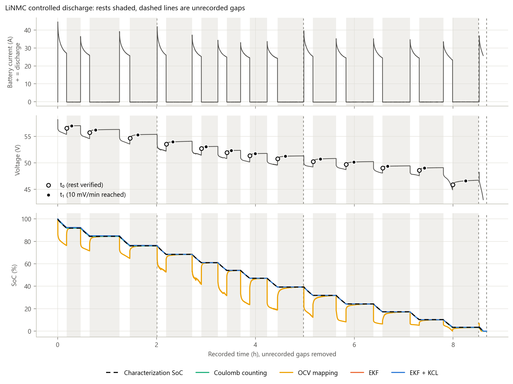

**Figure A1.** LiNMC controlled discharge (ADS1115, 18 Mar – 8 Apr 2026, 8.68 h logged in four sessions): battery current, terminal voltage, and the SoC of the four methods.
- The dashed black line ("Characterization SoC") is the **sensor-derived characterization SoC**, the integrated mean of the battery and load sensors. It is not a reference SoC.
- All methods start from that line at t = 0.
- Rests (13) are shaded. Dashed vertical lines are unrecorded breaks between sessions.
- In-sample: the battery model was fitted to this run. Made by `controlled_evaluation.ipynb`.

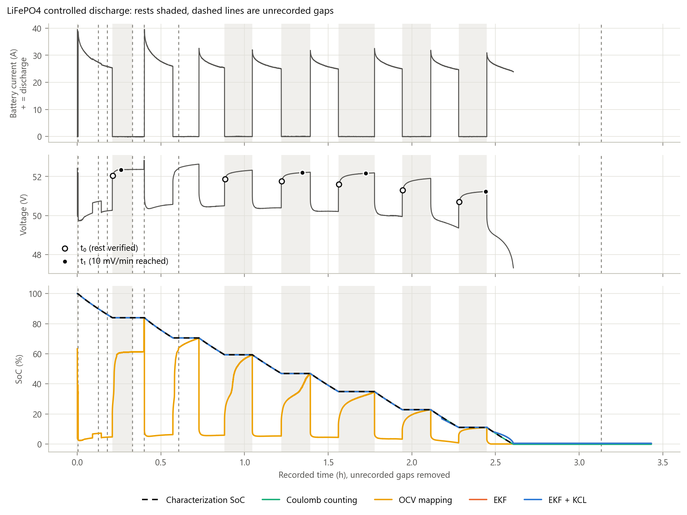

**Figure A2.** LiFePO4 controlled discharge (ADS8688, 25 May 2026, 3.43 h logged in eight files). Layout as Figure A1. Six rests. In-sample.

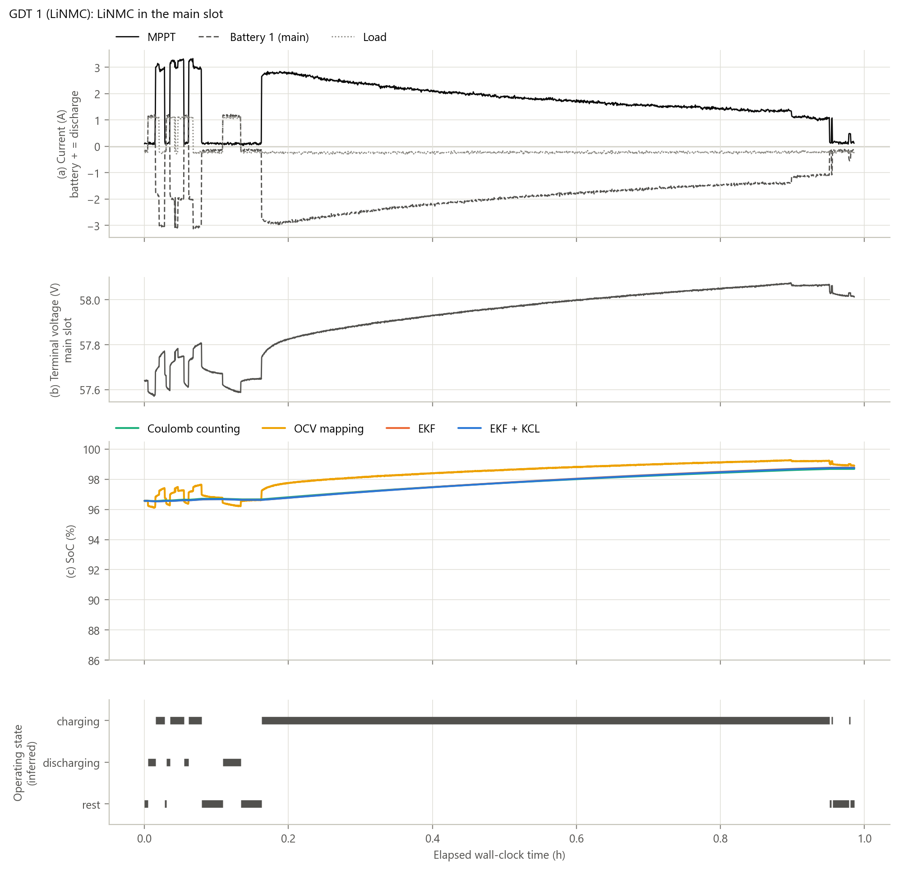

**Figure A3.** GDT 1: LiNMC, main slot, 12 Jun 2026, ADS8688, 0.99 h, no unrecorded intervals. Charging near full, a short discharge and short quiet periods, with no verified rest of 2 min or more. Panels as Figure R5. Start: 96.57 %.

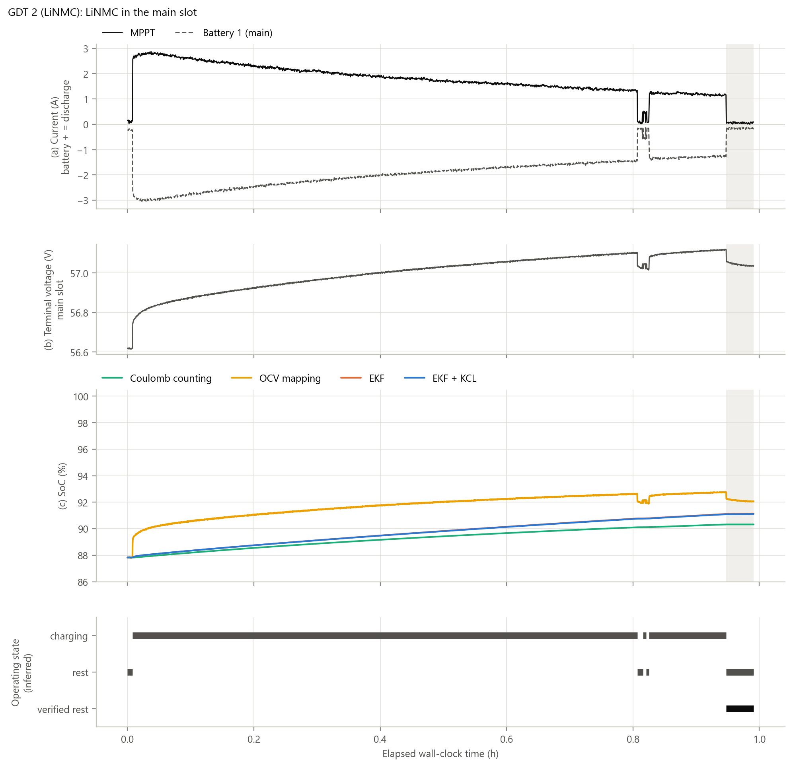

**Figure A4.** GDT 2: LiNMC, main slot, 12 Jun 2026, ADS8688, 0.99 h. Charging near full, with one verified rest (2.6 min, after charge, shaded). Panels as Figure R5. Start: 87.83 %.

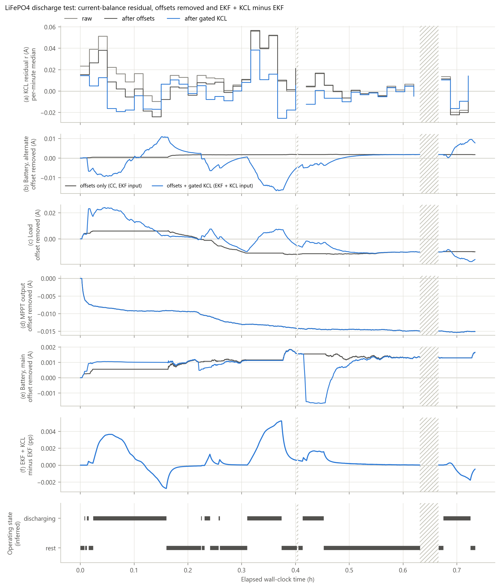

**Figure A5.** Current-balance correction on the LiFePO4 operational run (alternate slot, 22 Jun 2026, 0.73 h). Panels as Figure R11, plus the idle LiNMC in the main slot. Two logger stalls are hatched.

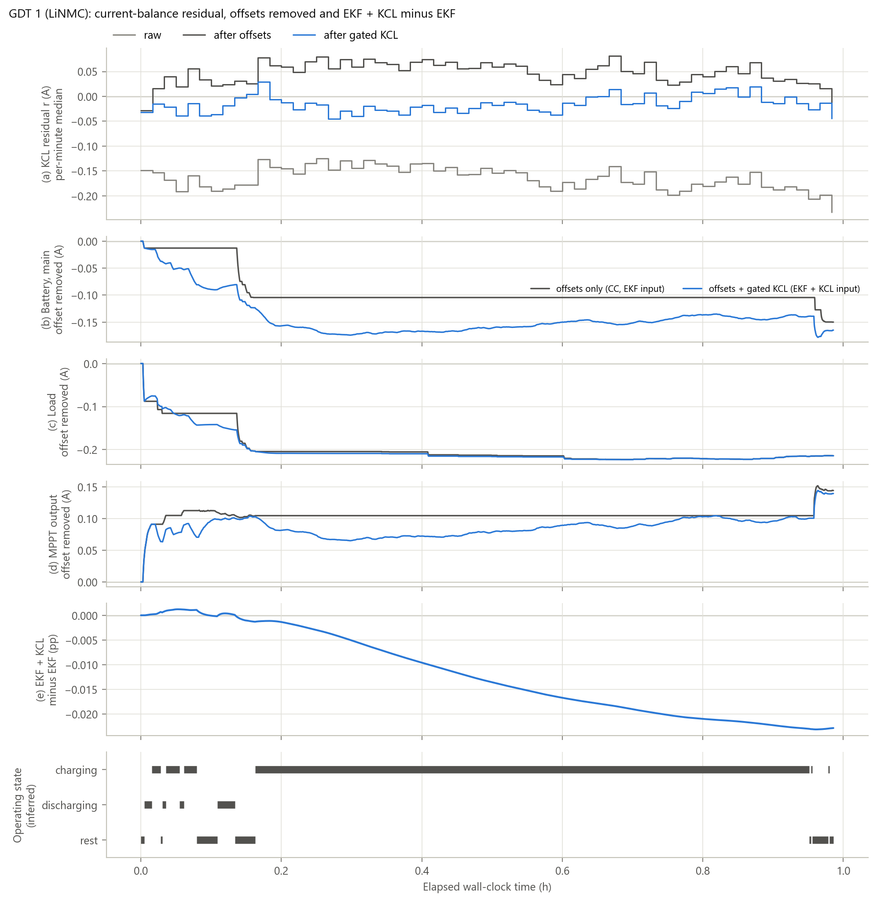

**Figure A6.** Current-balance correction on GDT 1 (LiNMC, 12 Jun 2026, 0.99 h). Panels as Figure R11.

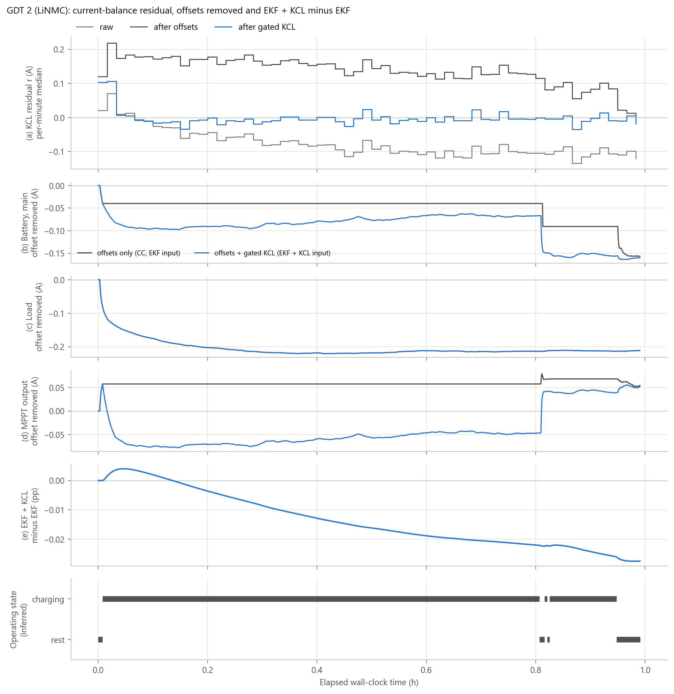

**Figure A7.** Current-balance correction on GDT 2 (LiNMC, 12 Jun 2026, 0.99 h). Panels as Figure R11.

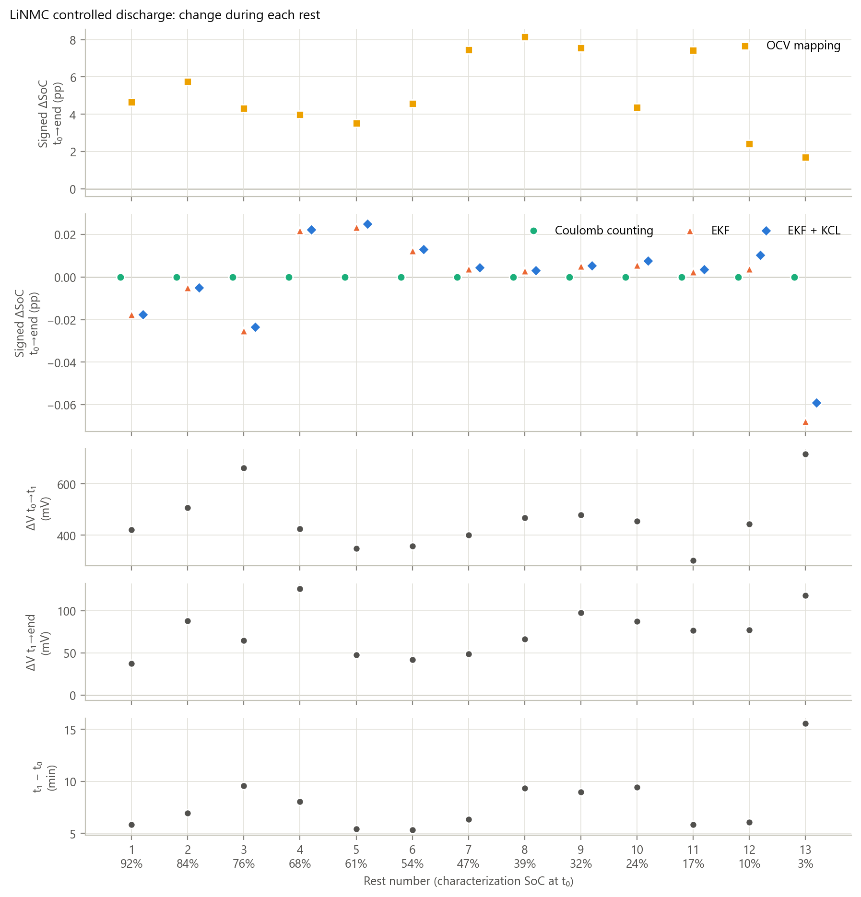

**Figure A8.** LiNMC controlled run, all 13 rests (ADS1115). From top:
- signed SoC change of OCV mapping, then of CC, EKF and EKF + KCL (t₀ → end);
- voltage change t₀ → t₁ and t₁ → end;
- time from t₀ to t₁.

In-sample. Made by `controlled_evaluation.ipynb`.

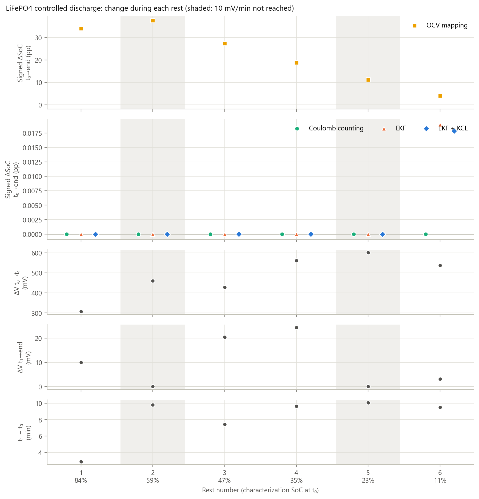

**Figure A9.** LiFePO4 controlled run, all 6 rests (ADS8688). Layout as Figure A8. The rests where the logged voltage never reached 10 mV/min (2 and 5) are shaded. In-sample.

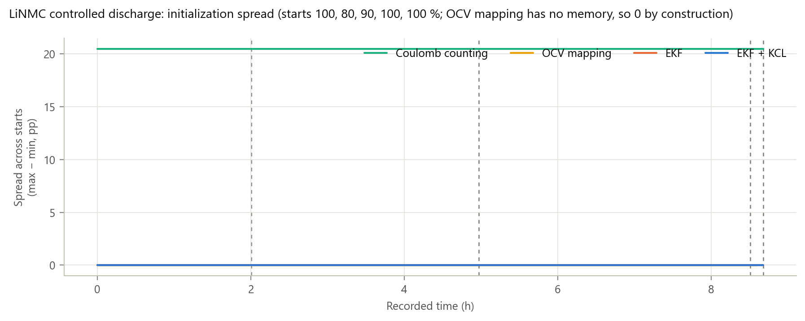

**Figure A10.** LiNMC controlled run: within-method spread across replays started at the characterization SoC at t = 0 and at ±10 and ±20 pp from it, clipped to 0–100 %. This is a different set of starts from Figure R10. In-sample.

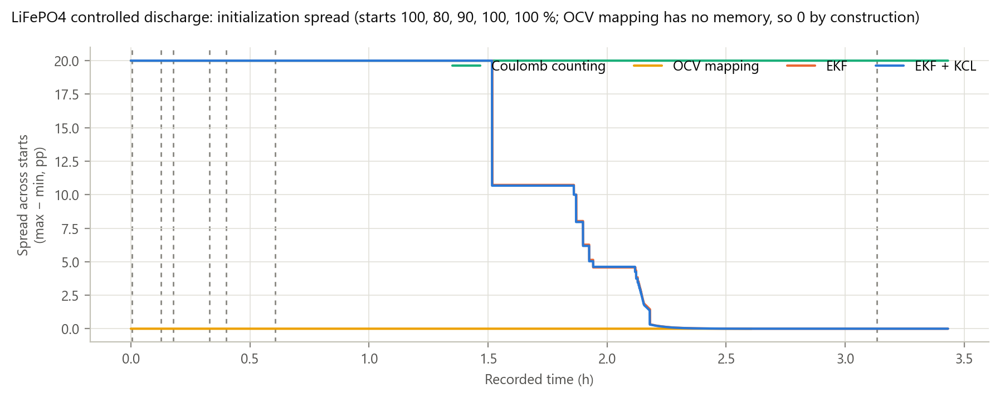

**Figure A11.** LiFePO4 controlled run. Starts and layout as Figure A10. The EKF spread first fell below 1 pp at 2.18 h. In-sample.

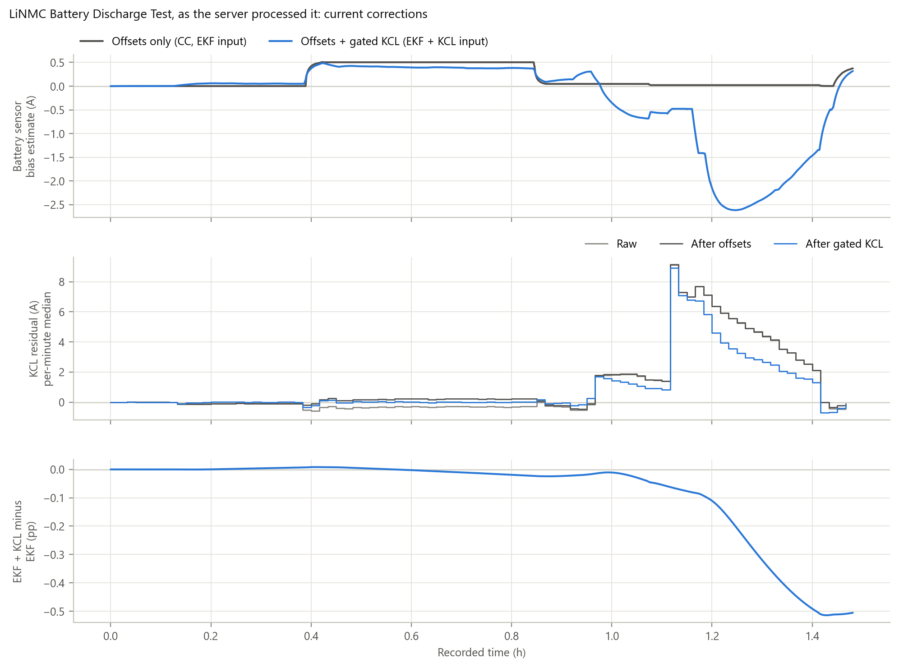

**Figure A12.** The 29 Jun LiNMC run as the monitoring server processed it at the time. After one −10.24 A sample, the server's MPPT flip latch negated every later MPPT reading. This produced a sustained single-channel error that the recorded data do not contain. Panels:
- the battery offset learned by offset correction alone and with the gated KCL update;
- the KCL residual before and after correction;
- EKF + KCL minus EKF.

Numbers are in Table R13. Made by `operational_evaluation.ipynb`, section 2.8.

## Appendix B. Supplementary tables

**Table B1.** Controlled runs: each method's difference from the sensor-derived characterization estimate, d = method − characterization SoC (pp).
- **Scored windows:** LiNMC 3.4–92 % SoC, without the 8 Apr session that follows a week of rest; LiFePO4 11–84 % SoC.
- Coulomb counting is not listed. It integrates the same sensors that produced the characterization SoC, so it is not scored against those labels.
- All values are in-sample and do not rank the methods.
- At the rest ends, OCV mapping returns the voltage points the curve was built from, so its small rest-end values there are an implementation check.

| Battery   | Method      |   RMS d (pp) |   max |d| (pp) |   d at end of window (pp) |   median |d| at rest ends (pp) |   max |d| at rest ends (pp) |   voltage innovation RMS (mV) |
|:----------|:------------|-------------:|---------------:|--------------------------:|-------------------------------:|----------------------------:|------------------------------:|
| LiNMC     | OCV mapping |        9.335 |         25.024 |                    -3.406 |                          0.131 |                       0.429 |                       –       |
| LiNMC     | EKF         |        0.248 |          0.597 |                     0.115 |                          0.070 |                       0.542 |                        35.978 |
| LiNMC     | EKF + KCL   |        0.250 |          0.597 |                     0.087 |                          0.071 |                       0.542 |                        36.077 |
| LiFePO4   | OCV mapping |       33.871 |         79.323 |                   -10.245 |                          0.015 |                      22.828 |                       –       |
| LiFePO4   | EKF         |        0.127 |          1.074 |                     0.075 |                          0.036 |                       0.120 |                       215.275 |
| LiFePO4   | EKF + KCL   |        0.133 |          1.125 |                     0.077 |                          0.049 |                       0.120 |                       214.704 |

**Table B2.** Every verified rest: length, whether the logged voltage reached 10 mV/min, voltage change, unrecorded time inside the rest, and each method's signed SoC change from t₀ to the end (pp). Controlled rests are in-sample for OCV mapping and the EKF.

| Run                          |   Rest | After           |   Length (min) | 10 mV/min reached   |   ΔV t₀→end (mV) |   Unrecorded inside (s) |   CC (pp) |   OCV mapping (pp) |   EKF (pp) |   EKF + KCL (pp) |
|:-----------------------------|-------:|:----------------|---------------:|:--------------------|-----------------:|------------------------:|----------:|-------------------:|-----------:|-----------------:|
| GDT 2 (LiNMC, 12 Jun)        |      1 | after charge    |          2.598 | yes                 |          -21.125 |                   0.000 |    -0.000 |             -0.182 |      0.024 |            0.023 |
| LiFePO4 operational (22 Jun) |      1 | after discharge |          3.565 | no                  |          208.125 |                   0.000 |     0.000 |              1.022 |      0.635 |            0.636 |
| LiFePO4 operational (22 Jun) |      2 | after discharge |          3.065 | no                  |           69.609 |                   0.000 |     0.000 |              0.338 |      0.232 |            0.231 |
| LiFePO4 operational (22 Jun) |      3 | after discharge |          2.145 | no                  |           59.625 |                  10.999 |     0.000 |              0.278 |      0.217 |            0.214 |
| LiFePO4 operational (22 Jun) |      4 | after discharge |         11.245 | yes                 |          110.625 |                 124.999 |     0.000 |              0.511 |      0.454 |            0.453 |
| LiFePO4 controlled           |      1 | after discharge |          7.127 | yes                 |          316.734 |                 –       |     0.000 |             33.930 |     -0.000 |            0.000 |
| LiFePO4 controlled           |      2 | after discharge |          9.970 | no                  |          460.031 |                 –       |     0.000 |             37.558 |      0.000 |            0.000 |
| LiFePO4 controlled           |      3 | after discharge |         10.420 | yes                 |          448.594 |                 –       |     0.000 |             27.357 |      0.000 |            0.000 |
| LiFePO4 controlled           |      4 | after discharge |         12.951 | yes                 |          585.875 |                 –       |     0.000 |             18.818 |      0.000 |            0.000 |
| LiFePO4 controlled           |      5 | after discharge |         10.230 | no                  |          600.563 |                 –       |     0.000 |             11.105 |     -0.000 |            0.000 |
| LiFePO4 controlled           |      6 | after discharge |         10.087 | yes                 |          539.594 |                 –       |     0.000 |              4.056 |      0.019 |            0.018 |
| LiNMC controlled             |      1 | after discharge |         16.960 | yes                 |          458.398 |                 –       |     0.000 |              4.650 |     -0.018 |           -0.018 |
| LiNMC controlled             |      2 | after discharge |         36.272 | yes                 |          594.531 |                 –       |     0.000 |              5.762 |     -0.005 |           -0.005 |
| LiNMC controlled             |      3 | after discharge |         32.852 | yes                 |          727.656 |                 –       |     0.000 |              4.303 |     -0.025 |           -0.024 |
| LiNMC controlled             |      4 | after discharge |         31.553 | yes                 |          550.078 |                 –       |     0.000 |              3.990 |      0.022 |            0.022 |
| LiNMC controlled             |      5 | after discharge |         20.068 | yes                 |          396.000 |                 –       |     0.000 |              3.513 |      0.023 |            0.025 |
| LiNMC controlled             |      6 | after discharge |         16.788 | yes                 |          399.188 |                 –       |     0.000 |              4.579 |      0.012 |            0.013 |
| LiNMC controlled             |      7 | after discharge |         21.128 | yes                 |          448.828 |                 –       |     0.000 |              7.452 |      0.004 |            0.004 |
| LiNMC controlled             |      8 | after discharge |         31.279 | yes                 |          534.234 |                 –       |     0.000 |              8.145 |      0.003 |            0.003 |
| LiNMC controlled             |      9 | after discharge |         28.149 | yes                 |          577.000 |                 –       |     0.000 |              7.555 |      0.005 |            0.005 |
| LiNMC controlled             |     10 | after discharge |         33.360 | yes                 |          541.562 |                 –       |     0.000 |              4.374 |      0.005 |            0.008 |
| LiNMC controlled             |     11 | after discharge |         33.496 | yes                 |          377.891 |                 –       |     0.000 |              7.416 |      0.002 |            0.004 |
| LiNMC controlled             |     12 | after discharge |         29.290 | yes                 |          519.844 |                 –       |     0.000 |              2.404 |      0.004 |            0.010 |
| LiNMC controlled             |     13 | after discharge |         31.338 | yes                 |          833.813 |                 –       |     0.000 |              1.683 |     -0.068 |           -0.059 |

**Table B3.** Operational rests with a 1-min minimum instead of 2 min (sensitivity check; all other rules unchanged). With rests this short, the 60 s slope that defines t₁ is not informative.

| Battery   | After           | Method           |   Rests |   Median |ΔSoC| (pp) |   Max |ΔSoC| (pp) |   Signed min (pp) |   Signed max (pp) |   Median length (min) |   Median ΔV t₀→end (mV) |
|:----------|:----------------|:-----------------|--------:|---------------------:|------------------:|------------------:|------------------:|----------------------:|------------------------:|
| LiNMC     | after charge    | Coulomb counting |       5 |                0.000 |             0.000 |            -0.000 |             0.000 |                 1.588 |                 -21.125 |
| LiNMC     | after charge    | OCV mapping      |       5 |                0.146 |             0.205 |            -0.205 |            -0.029 |                 1.588 |                 -21.125 |
| LiNMC     | after charge    | EKF              |       5 |                0.009 |             0.029 |             0.003 |             0.029 |                 1.588 |                 -21.125 |
| LiNMC     | after charge    | EKF + KCL        |       5 |                0.010 |             0.027 |             0.003 |             0.027 |                 1.588 |                 -21.125 |
| LiNMC     | after discharge | Coulomb counting |       1 |                0.000 |             0.000 |             0.000 |             0.000 |                 1.723 |                  10.125 |
| LiNMC     | after discharge | OCV mapping      |       1 |                0.067 |             0.067 |             0.067 |             0.067 |                 1.723 |                  10.125 |
| LiNMC     | after discharge | EKF              |       1 |                0.000 |             0.000 |            -0.000 |            -0.000 |                 1.723 |                  10.125 |
| LiNMC     | after discharge | EKF + KCL        |       1 |                0.001 |             0.001 |            -0.001 |            -0.001 |                 1.723 |                  10.125 |
| LiFePO4   | after discharge | Coulomb counting |       4 |                0.000 |             0.000 |             0.000 |             0.000 |                 3.315 |                  90.117 |
| LiFePO4   | after discharge | OCV mapping      |       4 |                0.424 |             1.022 |             0.278 |             1.022 |                 3.315 |                  90.117 |
| LiFePO4   | after discharge | EKF              |       4 |                0.343 |             0.635 |             0.217 |             0.635 |                 3.315 |                  90.117 |
| LiFePO4   | after discharge | EKF + KCL        |       4 |                0.342 |             0.636 |             0.214 |             0.636 |                 3.315 |                  90.117 |

**Table B4.** Points of the short-rest voltage curves, as printed by `3.ocv-soc-fit.ipynb` when the battery models were built. Each point is labelled measured or constructed, with its leave-one-out and log-model residual.

| Battery   |   SoC (%) |   Voltage (V) | Point                                   |   Leave-one-out residual (mV) |   Log-model residual (mV) |
|:----------|----------:|--------------:|:----------------------------------------|------------------------------:|--------------------------:|
| LiNMC     |     -0.11 |         44.90 | end estimate (last loaded sample + I·R) |                        –      |                    –      |
| LiNMC     |      3.28 |         46.73 | rest end                                |                       -128.76 |                    -10.63 |
| LiNMC     |     10.17 |         49.10 | rest end                                |                        727.73 |                    143.52 |
| LiNMC     |     17.22 |         49.44 | rest end                                |                       -349.65 |                   -302.22 |
| LiNMC     |     24.24 |         50.26 | rest end                                |                        173.84 |                     31.78 |
| LiNMC     |     31.88 |         50.84 | rest end                                |                         -5.60 |                    153.69 |
| LiNMC     |     39.34 |         51.33 | rest end                                |                         23.25 |                    140.45 |
| LiNMC     |     47.23 |         51.80 | rest end                                |                        -45.70 |                    -13.87 |
| LiNMC     |     54.22 |         52.38 | rest end                                |                        -14.66 |                    -99.04 |
| LiNMC     |     61.16 |         53.12 | rest end                                |                         -1.52 |                   -120.84 |
| LiNMC     |     68.64 |         54.10 | rest end                                |                       -142.67 |                    -72.92 |
| LiNMC     |     76.31 |         55.41 | rest end                                |                        203.33 |                    191.65 |
| LiNMC     |     84.81 |         56.33 | rest end                                |                         37.30 |                    -28.72 |
| LiNMC     |     92.19 |         57.05 | rest end                                |                       -157.73 |                    -12.84 |
| LiNMC     |    100.00 |         58.20 | rested start                            |                        –      |                    –      |
| LiFePO4   |     -0.22 |         49.12 | end estimate (last loaded sample + I·R) |                        –      |                    –      |
| LiFePO4   |     10.96 |         51.24 | rest end                                |                        344.67 |                      7.54 |
| LiFePO4   |     22.82 |         51.90 | rest end                                |                         -5.73 |                    -41.66 |
| LiFePO4   |     34.83 |         52.19 | rest end                                |                         87.02 |                     63.15 |
| LiFePO4   |     46.86 |         52.22 | rest end                                |                        -33.58 |                     -6.46 |
| LiFePO4   |     59.29 |         52.33 | rest end                                |                        -83.14 |                    -59.12 |
| LiFePO4   |     70.49 |         52.63 | rest end                                |                        101.58 |                     43.94 |
| LiFePO4   |     83.95 |         52.83 | rest end                                |                        -54.43 |                     -7.40 |
| LiFePO4   |    100.00 |         53.06 | extrapolated to 100 %                   |                        –      |                    –      |

**Table B5.** Rests found by the rest rule on the controlled runs. The rule is all currents < 0.5 A for at least 5 min after a discharge in the same recording.
- t₀ is 10 s after the rest starts.
- t₁ is the first time the trailing 60 s voltage slope is within 10 mV/min. Where it is never reached, t₁ is the end of the rest.
- Voltages are means over ±2.5 s.

| Battery   |   Rest |   Length (min) |   t₁ − t₀ (min) | 10 mV/min reached   |   Current before (A) |   V at t₀ (V) |   V at t₁ (V) |   V at end (V) |   ΔV t₀→t₁ (mV) |   ΔV t₁→end (mV) |   Characterization SoC at end (%) |
|:----------|-------:|---------------:|----------------:|:--------------------|---------------------:|--------------:|--------------:|---------------:|----------------:|-----------------:|----------------------------------:|
| LiNMC     |      1 |          16.96 |            5.86 | yes                 |                31.13 |         56.59 |         57.01 |          57.05 |          421.05 |            37.34 |                             91.76 |
| LiNMC     |      2 |          36.27 |            6.94 | yes                 |                28.49 |         55.74 |         56.25 |          56.33 |          506.41 |            88.12 |                             84.47 |
| LiNMC     |      3 |          32.85 |            9.57 | yes                 |                28.87 |         54.67 |         55.33 |          55.40 |          663.25 |            64.41 |                             76.04 |
| LiNMC     |      4 |          31.55 |            8.06 | yes                 |                30.34 |         53.55 |         53.98 |          54.10 |          424.22 |           125.86 |                             68.43 |
| LiNMC     |      5 |          20.07 |            5.43 | yes                 |                28.13 |         52.73 |         53.07 |          53.12 |          348.19 |            47.81 |                             60.98 |
| LiNMC     |      6 |          16.79 |            5.36 | yes                 |                27.53 |         51.98 |         52.34 |          52.38 |          357.19 |            42.00 |                             54.07 |
| LiNMC     |      7 |          21.13 |            6.36 | yes                 |                26.69 |         51.35 |         51.75 |          51.80 |          400.27 |            48.56 |                             47.12 |
| LiNMC     |      8 |          31.28 |            9.34 | yes                 |                26.49 |         50.79 |         51.26 |          51.33 |          468.19 |            66.05 |                             39.28 |
| LiNMC     |      9 |          28.15 |            8.98 | yes                 |                28.94 |         50.26 |         50.74 |          50.84 |          479.58 |            97.42 |                             31.87 |
| LiNMC     |     10 |          33.36 |            9.43 | yes                 |                27.57 |         49.71 |         50.17 |          50.25 |          454.00 |            87.56 |                             24.27 |
| LiNMC     |     11 |          33.50 |            5.86 | yes                 |                27.49 |         49.06 |         49.37 |          49.44 |          301.17 |            76.72 |                             17.30 |
| LiNMC     |     12 |          29.29 |            6.10 | yes                 |                27.20 |         48.58 |         49.03 |          49.10 |          442.88 |            76.97 |                             10.29 |
| LiNMC     |     13 |          31.34 |           15.58 | yes                 |                26.22 |         45.89 |         46.61 |          46.73 |          715.92 |           117.89 |                              3.40 |
| LiFePO4   |      1 |           7.13 |            2.91 | yes                 |                25.59 |         52.04 |         52.35 |          52.36 |          306.75 |             9.98 |                             83.96 |
| LiFePO4   |      2 |           9.97 |            9.80 | no                  |                25.47 |         51.87 |         52.33 |          52.33 |          460.03 |             0.00 |                             59.31 |
| LiFePO4   |      3 |          10.42 |            7.41 | yes                 |                26.65 |         51.77 |         52.20 |          52.22 |          428.25 |            20.34 |                             46.88 |
| LiFePO4   |      4 |          12.95 |            9.63 | yes                 |                26.56 |         51.60 |         52.16 |          52.19 |          561.56 |            24.31 |                             34.85 |
| LiFePO4   |      5 |          10.23 |           10.06 | no                  |                26.78 |         51.30 |         51.90 |          51.90 |          600.56 |             0.00 |                             22.84 |
| LiFePO4   |      6 |          10.09 |            9.51 | yes                 |                26.36 |         50.70 |         51.23 |          51.24 |          536.44 |             3.16 |                             10.98 |

## Appendix C. Figure-to-data map

Every `res_*` figure is made by `final_report/results_chapter.ipynb` with the functions listed from `final_report/soc_eval.py`. Its tables are saved as `final_report/tables/res_*.csv` (and `.md`). The remaining figures are copied from the notebooks named. The test data are in `proa_advisor/model/battery_model/test_data/`.

| figure   | file                                                         | made by                                         | data                                                                        | soc_eval functions                                                                                       |
|:---------|:-------------------------------------------------------------|:------------------------------------------------|:----------------------------------------------------------------------------|:---------------------------------------------------------------------------------------------------------|
| A1       | figures/LiNMC_controlled_whole_run.png                       | controlled_evaluation.ipynb (BATTERY = LiNMC)   | see that notebook                                                           | –                                                                                                        |
| A2       | figures/LiFePO4_controlled_whole_run.png                     | controlled_evaluation.ipynb (BATTERY = LiFePO4) | see that notebook                                                           | –                                                                                                        |
| A3       | figures/res_op_General_Discharge_Test_panels.png             | results_chapter.ipynb, section 4.3              | General Discharge Test                                                      | plot_operational_panels                                                                                  |
| A4       | figures/res_op_General_Discharge_Test_2_panels.png           | results_chapter.ipynb, section 4.3              | General Discharge Test 2                                                    | plot_operational_panels                                                                                  |
| A5       | figures/res_kcl_LiFePO4_Battery_Discharge_Test.png           | results_chapter.ipynb, section 4.6              | LiFePO4 Battery Discharge Test                                              | plot_kcl_channels                                                                                        |
| A6       | figures/res_kcl_General_Discharge_Test.png                   | results_chapter.ipynb, section 4.6              | General Discharge Test                                                      | plot_kcl_channels                                                                                        |
| A7       | figures/res_kcl_General_Discharge_Test_2.png                 | results_chapter.ipynb, section 4.6              | General Discharge Test 2                                                    | plot_kcl_channels                                                                                        |
| A8       | figures/LiNMC_controlled_rest_summary.png                    | controlled_evaluation.ipynb (BATTERY = LiNMC)   | see that notebook                                                           | –                                                                                                        |
| A9       | figures/LiFePO4_controlled_rest_summary.png                  | controlled_evaluation.ipynb (BATTERY = LiFePO4) | see that notebook                                                           | –                                                                                                        |
| A10      | figures/LiNMC_controlled_init_spread.png                     | controlled_evaluation.ipynb (BATTERY = LiNMC)   | see that notebook                                                           | –                                                                                                        |
| A11      | figures/LiFePO4_controlled_init_spread.png                   | controlled_evaluation.ipynb (BATTERY = LiFePO4) | see that notebook                                                           | –                                                                                                        |
| A12      | figures/op_LiNMC_Battery_Discharge_Test_kcl_server_latch.png | operational_evaluation.ipynb, section 2.8       | see that notebook                                                           | –                                                                                                        |
| R1       | figures/res_char_run_LiNMC.png                               | results_chapter.ipynb, section 4.1              | LiNMC Remapped                                                              | load_run, window_median, find_rests, active_blocks, plot_char_run                                        |
| R2       | figures/res_char_run_LiFePO4.png                             | results_chapter.ipynb, section 4.1              | LiFePO4 Remapped                                                            | load_run, window_median, find_rests, active_blocks, plot_char_run                                        |
| R3       | figures/res_rest_voltage_fit.png                             | results_chapter.ipynb, section 4.1              | 3.ocv-soc-fit.ipynb outputs (both batteries), points_of_interest.json | ocv_knots, ocv_fit_residuals, plot_rest_voltage_fit                                                      |
| R4       | figures/res_offset_timeline.png                              | results_chapter.ipynb, section 4.2              | all six runs                                                                | idle_windows, learned_offsets (offsets from kcl_batch or run_methods with OFFSETS), plot_offset_timeline |
| R5       | figures/res_op_LiNMC_Battery_Discharge_Test_panels.png       | results_chapter.ipynb, section 4.3              | LiNMC Battery Discharge Test                                                | run_operational, record_state, find_rests, gap_table, plot_operational_panels                            |
| R6       | figures/res_op_LiFePO4_Battery_Discharge_Test_panels.png     | results_chapter.ipynb, section 4.3              | LiFePO4 Battery Discharge Test                                              | run_operational, record_state, find_rests, gap_table, plot_operational_panels                            |
| R7       | figures/res_op_pairwise.png                                  | results_chapter.ipynb, section 4.3              | four operational runs                                                       | pairwise, plot_pairwise_all                                                                              |
| R8       | figures/res_rest_closeups.png                                | results_chapter.ipynb, section 4.4              | operational runs (median-length rest of each type)                          | find_rests, plot_rest_closeups                                                                           |
| R9       | figures/res_rest_pairs.png                                   | results_chapter.ipynb, section 4.4              | operational runs + controlled rest tables                                   | rest_deltas, rest_points, rest_long, plot_rest_pairs                                                     |
| R10      | figures/res_init_spread.png                                  | results_chapter.ipynb, section 4.5              | four operational runs                                                       | run_operational (INIT_GRID replays), plot_init                                                           |
| R11      | figures/res_kcl_LiNMC_Battery_Discharge_Test.png             | results_chapter.ipynb, section 4.6              | LiNMC Battery Discharge Test                                                | run_methods (OFFSETS, KCL_GATED), plot_kcl_channels                                                      |

**Table-to-file map.**

| Table | File |
|---|---|
| R1 | `tables/res_data_intervals.csv` |
| R2 | `tables/res_method_config.csv` |
| R3 | `tables/res_char.csv` |
| R4 | `tables/res_offsets.csv`, `tables/res_offset_windows.csv` |
| R5 | `tables/res_offset_charge.csv` |
| ADC comparison | `tables/res_offset_adc.csv` |
| R6 | `tables/res_op_start_end.csv` |
| R7 | `tables/res_op_pairwise.csv` |
| R8 | `tables/res_op_by_state.csv` |
| R9 | `tables/res_rest_summary.csv` |
| R10 | `tables/res_init.csv` |
| R11 | `tables/res_kcl_by_state.csv` |
| R12 | `tables/res_kcl_charge.csv` |
| R13 | `tables/res_kcl_latch.csv`, copied from `tables/op_LiNMC_Battery_Discharge_Test_latch_evidence.csv` |
| B1 | `tables/summary_characterization.csv` (`summary.ipynb`) |
| B2 | `tables/res_rest_all.csv`, `tables/res_rest_list.csv` |
| B3 | `tables/res_rest_summary_1min.csv` |
| B4 | `tables/res_char_knots.csv` |
| B5 | `tables/res_char_rest_points.csv` |

## Appendix D. Missing data and placeholders

The Results chapter marks each item below as **[MISSING: …]** where it applies. None of these values were invented or estimated.

| # | Missing field or file | Where it is needed | What the analysis does instead |
|---|---|---|---|
| D1 | Dates of the current-sensor (rheostat) and voltage (oscilloscope) calibration sessions | Current Sensor Offset: calibration events on Figure R4 | No calibration events are marked. The one current function in `proa_advisor/lib/adc_converter.js` is applied to every run and channel. |
| D2 | Coefficients of a fitted voltage calibration, if one was made | Table R2; every voltage-based result | The nominal ADS8688 range-5 conversion × 6 (100 kΩ/20 kΩ divider) from `adc_converter.js` is applied, with no fitted gain or offset. |
| D3 | Records of zero-offset checks before and after each calibration or measurement sequence | Current Sensor Offset | Zero readings are taken from the idle periods inside the logged runs (Table R4). |
| D4 | How the 0.081 Ah sensor-draw estimate was obtained | Table R3 (Q_total of both batteries) | The constant `sensor_draw_estimate = 0.081` in `3.ocv-soc-fit.ipynb` is used as recorded. |
| D5 | Selector-switch positions during each operational run | SoC Estimates for Operational Test; Effect of KCL Correction | Operating states are inferred from the measured currents. A slot counts as connected while its voltage is above 30 V. |
| D6 | Whether the 48–24 V converter that powers the sensor board and Raspberry Pi (`Hardware Schematics/Electrical Schematics/Final Design/Final Design.kicad_sch`) draws through a metered branch during the tests | Effect of KCL Correction (omitted branches) | The four measured branches (HE1–HE4) are treated as the whole junction. |
| D7 | Exact length of the LiFePO4 controlled recording gap between files `data_20260525-121722` and `data_20260525-130002` | Table R1; Figure R2 | The gap is reported as a range: 31.5 min (logger's first time step) to 38.5 min (file-name start times plus logged length). |
| D8 | Battery or ambient temperature | Current Sensor Offset; Battery Characterization Result | Not recorded. No result is attributed to temperature. |

## Appendix E. Reproducing the results

1. Install pandas, numpy, scipy and matplotlib (the calibration notebooks list three of them in `final_report/Calibration Code/requirements.txt`), plus `tabulate`, which writes the Markdown tables.
2. Run `final_report/controlled_evaluation.ipynb` twice (`BATTERY = 'LiNMC'`, then `'LiFePO4'`), and `final_report/operational_evaluation.ipynb` with `RUN = 'LiNMC Battery Discharge Test'`. These write the controlled rest tables and the 29 Jun latch table that this chapter reads. The figures in Appendix A that they make are copied as they are.
3. Run `final_report/results_chapter.ipynb` top to bottom (about 30 minutes). It does the following:
   - writes every `res_*` figure to `final_report/figures/` and every `res_*` table, as CSV and Markdown, to `final_report/tables/`;
   - prints the numbers quoted in the text;
   - copies every figure used here into `final_report/results_section/figures/`.
4. All analysis code is in `final_report/soc_eval.py`:
   - the estimator and corrector ports are at the top of the file;
   - the block headed "results chapter" holds everything specific to this chapter.

   With the original settings, the Python ports reproduce the server's JavaScript output (`proa_advisor/lib/Kalman Filter/`).
