# Results

This chapter reports what the recorded controlled discharge and operational tests show. Every figure and table comes from `final_report/results_chapter.ipynb`, run on the data files in Table R1. Appendix C maps each figure to its data and code. Interpretation is left to the Discussion.

Three conventions apply throughout:

- **No reference SoC.** No independent, continuous reference SoC exists for any run.
  - On the controlled runs, the comparison line is the **sensor-derived characterization SoC**: the integrated mean of the battery and load current sensors. A gap between a method and that line is a **difference from the characterization estimate**.
  - On the operational runs, differences between methods are **method disagreement**.
- **Units and signs.** SoC differences are in percentage points (pp). Battery current is positive when discharging.
- **In-sample models.** Each battery's model (capacity, short-rest voltage curve, 2RC parameters) was fitted to that battery's controlled run. Agreement on those runs is in-sample and is not used to rank the methods. The estimator settings were tuned on the controlled runs, and the operational runs were also replayed as checks during that tuning.

**Data and the ADC change.** Table R1 lists the six recorded runs, the ADC that logged each, and every unrecorded interval longer than 5 s.
- The ADS1115 was replaced by the ADS8688 between the last LiNMC controlled session (8 Apr 2026) and the LiFePO4 controlled run (25 May 2026).
- The logged files confirm the change. Before it, the time step is 32 ms and four spare channels hold constant values. After it, the step is 0.87–0.94 ms and all eight channels vary.
- No run spans the change. A step in a signal at the moment of the change can therefore not be observed within a run; the Current Sensor Offset section compares the zero readings on either side.
- Every method reads the same 10-sample median stream. That stream spans 0.32 s of ADS1115 data and about 9 ms of ADS8688 data. This preprocessing difference comes from the ADC and is shared by all methods.

**Table R1.** Recorded runs, in date order.

| Run | Date | Battery (slot) | ADC; logged step | Logged time | Unrecorded intervals > 5 s | Corrections and notes |
|---|---|---|---|---|---|---|
| LiNMC controlled | 18 Mar – 8 Apr 2026 | LiNMC (main) | ADS1115; 32 ms (ch3–ch5, ch7 constant) | 8.68 h in 5 sessions | 3 breaks of 6.9 d between sessions; 1 of 2.6 min | MPPT and alternate slot not connected. Battery current logged on ch0 and remapped to ch2. The load sensor is on the same current path. |
| LiFePO4 controlled | 25 May 2026 | LiFePO4 (main) | ADS8688; 0.94 ms | 3.43 h in 8 files | 7 breaks of 7 s to 60 min; one is 31.5–38.5 min **[MISSING: exact length, D7]** | MPPT not connected. Load sensor reversed and mirrored in software. 0.82 h below 30 V after the BMS cut-off excluded. |
| GDT 1 | 12 Jun 2026 | LiNMC (main) | ADS8688; 0.87 ms | 0.99 h | none | A separate 1.4-min recording at 16:37 is left out. |
| GDT 2 | 12 Jun 2026 | LiNMC (main) | ADS8688; 0.87 ms | 0.99 h | none | – |
| LiFePO4 operational | 22 Jun 2026 | LiFePO4 (alternate) | ADS8688; 0.87 ms | 0.70 h (0.73 h wall clock) | 2 logger stalls, 2.3 min in total | LiNMC connected in the main slot and idle. Server restarts (run ids 1–8) replayed as one run. |
| LiNMC operational | 29 Jun 2026 | LiNMC (main) | ADS8688; 0.87 ms | 1.48 h (1.65 h wall clock) | 32 logger stalls, 10.4 min in total; 0.24 Ah passed while unrecorded | MPPT current used with its recorded sign. The server's MPPT flip latch would have negated every reading after one −10.24 A sample. |

**Table R2.** Configuration of the four methods. One setting is shared by all methods:
- a 10-sample median stream;
- samples below the 30 V cutoff excluded;
- records every 1 s;
- current conversion I = sign(x)(0.90225x² + 15.0635|x|) on every channel;
- voltage conversion: nominal ADS8688 range × 6 **[MISSING: fitted voltage calibration, D2]**.

| | Current input | Voltage input | Model parameters used | Battery-specific settings | Initial state |
|---|---|---|---|---|---|
| Coulomb counting (CC) | Offset-corrected battery current | none | Q_total | – | SoC₀; never corrected afterwards |
| OCV mapping | none | Terminal voltage at every step. The short-rest curve is applied without IR compensation, also while current flows. | Inverse of the short-rest voltage curve | – | None (no memory) |
| EKF | Offset-corrected battery current | Terminal voltage, through the 2RC model | Q_total; OCV, R0, R1, C1, R2, C2 against SoC | Both batteries: process noise q_rc 1e-7 V²/s, R = 1e-4 V²·s ÷ dt, P0_soc 1e-2. LiNMC: q_soc 1e-12 /s; RC voltages reset at recording breaks. LiFePO4: q_soc 1e-9 /s; RC voltages relax over recording breaks. The LiFePO4 voltage update runs only where \|dOCV/dSoC\| ≥ 5 V per unit SoC, or after 300 s at \|I\| < 1 A when the rested voltage maps to such a part of the curve. | SoC₀; RC voltages 0 |
| EKF + KCL | Battery current after offsets **and** the gated KCL update (R 2.5e-3 A²·s ÷ dt, 4σ gate) | as EKF | as EKF | as EKF | as EKF |

Offset correction is a shared input step, not one of the compared methods. It works as follows:
- A sensor is **idle** when:
  - load or MPPT: its reading stays below 0.3 A for 10 s;
  - battery: its reading stays below 1 A for 10 s while load and MPPT are idle.
- While a sensor is idle, its offset is learned. While it is active, the learned offset is subtracted.
- Readings below 0.3 A are output as 0 A.

## Battery Characterization Result

Table R3 summarizes both controlled discharges. Figures R1 and R2 show the current and terminal voltage over each run.

**Endpoints and charge.**

*LiNMC*
- **Start:** the first sample of the 18 Mar session, at 58.20 V after a rest. This voltage is the 100 % point of the short-rest curve.
- **End:** the last sample above 30 V before the BMS cut-off on 8 Apr (43.00 V).
- **Charge out:** 69.84 Ah on the battery sensor and 72.34 Ah on the load sensor, which measures the same current. The load total is 3.5 % above the battery total.
- **Usable capacity:** Q_total = 71.43 Ah, 71.4 % of the rated 100 Ah. It is the zero-corrected mean of the two sensors with negative values clipped, minus a 0.081 Ah sensor-draw estimate **[MISSING: derivation of the 0.081 Ah estimate, D4]**.

*LiFePO4*
- **Start:** the first sample on 25 May, at 52.42 V. This voltage is lower than rests taken later in the run, so it was not used as a short-rest voltage, and the 100 % point of the curve is extrapolated.
- **End:** 47.32 V.
- **Charge out:** 37.00 Ah on the battery sensor and 37.05 Ah on the load sensor (0.15 % apart).
- **Usable capacity:** Q_total = 37.01 Ah, 74.0 % of the rated 50 Ah.

**Steps and rests.**

*LiNMC*
- 14 discharge steps, with mean currents of 26.2–31.1 A and lengths of 4.9–12.6 min (median 11.1 min).
- 13 rests (17–36 min).
- The four recording sessions are separated by unrecorded rests of 6.9 days (Figure R1, dashed lines).

*LiFePO4*
- 11 discharge steps (25.5–30.4 A).
- Some steps are split by recording breaks, which is why the shortest is 0.7 min. Median step length: 9.5 min.
- The rest rule (all currents < 0.5 A for at least 5 min, after a discharge in the same recording) finds 6 rests of 7.1–13.0 min.
- The short-rest curve uses 7 rest-end voltages. The extra point, at 70 % SoC, comes from a rest that a 1.2-min recording break splits into two parts, so the rule does not count it.
- No current or voltage was recorded during the 31.5–38.5 min break inside the ~84 % rest, or after the BMS cut-off (Figure R2, hatched).

**The 10 mV/min criterion.** During the tests, the criterion was checked with a handheld multimeter. Here it is checked afterwards on the logged voltage: the first time the trailing 60 s slope of the voltage is within 10 mV/min (t₁, dots in Figures R1 and R2).
- **LiNMC:** reached in all 13 rests, 5.4–15.6 min after t₀. The voltage then rose by up to a further 126 mV before the rest ended.
- **LiFePO4:** reached in 4 of 6 rests (2.9–9.6 min after t₀). It was **not** reached in the rests ending at 59.3 % and 22.8 % SoC, which lasted 10.0 and 10.2 min.

The rest-end voltages are therefore reported as **short-rest voltages**, not equilibrium OCV.

**Short-rest voltage curve.** Figure R3 plots the measured short-rest voltages against the sensor-derived characterization SoC, with the curve the estimators use.
- **The curve.** It is a piecewise-cubic (PCHIP) interpolant through the points, so its residual at every point is 0 by construction. Two constructed points close it at the ends:
  - the last loaded sample plus I·R at about 0 %;
  - for LiFePO4, an extrapolation to 100 %.
- **Two descriptive residuals.** Both are computed on the same points, so they are not validation.
  - Leave-one-out residual: each point against the curve through all the other points. RMS 246 mV (LiNMC) and 145 mV (LiFePO4).
  - Residual from a smooth five-parameter log model fitted to the measured points: RMS 131 mV, largest 302 mV (LiNMC); RMS 40 mV, largest 63 mV (LiFePO4).
- **Irregular LiNMC points.** The 17.2 % point (49.44 V) lies 302 mV below the log model and 350 mV below its neighbours' interpolation. The 10.2 % point lies 728 mV above the leave-one-out curve, at the knee of the curve.
- **Irregular LiFePO4 points.** The 11.0 % point gives the largest leave-one-out residual (+345 mV), at the start of the steep low-SoC region. The two rests that never reached 10 mV/min (59.3 % and 22.8 %) are ringed in Figure R3; their log-model residuals are −59 mV and −42 mV.
- **Flat region.** Between 22.8 % and 59.3 % SoC, the LiFePO4 points span 422 mV, or 11.6 mV per pp of SoC. The LiNMC points between 24.2 % and 61.2 % span 2.87 V, or 77.7 mV per pp.

The appendix shows the estimator traces over the controlled runs (Figures A1 and A2) and their differences from the characterization estimate (Table B1). These are in-sample and are not used to rank methods.

Both the capacity and the SoC axis of Figure R3 come from integrating Hall-effect sensor current. The zero reading of those sensors is examined next.

**Table R3.** Characterization runs.

| | LiNMC | LiFePO4 |
|---|---|---|
| ADC | ADS1115 | ADS8688 |
| Recording | 18 Mar – 8 Apr 2026; 5 sessions; 8.68 h logged | 25 May 2026; 8 files; 3.43 h logged |
| Start of discharge | first sample, 18 Mar 16:00, 58.20 V (rested) | first sample, 25 May 11:54, 52.42 V (not rested) |
| End of discharge | last sample above 30 V before the BMS cut-off, 43.00 V | last sample above 30 V before the BMS cut-off, 47.32 V |
| Charge out: battery / load / mean of the raw sensors (Ah) | 69.84 / 72.34 / 71.09 | 37.00 / 37.05 / 37.03 |
| Usable capacity Q_total (Ah); % of rated | 71.43; 71.4 % of 100 Ah | 37.01; 74.0 % of 50 Ah |
| Discharge steps (battery \|I\| > 1 A, ≥ 30 s) | 14 | 11 |
| Step mean current (A) | 26.2 – 31.1 | 25.5 – 30.4 |
| Step length, min / median / max (min) | 4.9 / 11.1 / 12.6 | 0.7 / 9.5 / 10.4 |
| Rests (all currents < 0.5 A, ≥ 5 min) | 13 | 6 |
| Rest length, min / median / max (min) | 16.8 / 31.3 / 36.3 | 7.1 / 10.2 / 13.0 |
| Short-rest voltages in the curve | 13 + rested start | 7 |
| Constructed curve points | end estimate (last loaded sample + I·R) | end estimate; extrapolation to 100 % |
| Logged voltage within 10 mV/min | 13 of 13 rests | 4 of 6 rests |
| t₁ − t₀ where reached (min) | 5.4 – 15.6 | 2.9 – 9.6 |
| Largest voltage rise after t₁ (mV) | 126 | 24 |
| Time below the 30 V cutoff, excluded (h) | 0.07 | 0.82 |
| Leave-one-out residual, RMS / max \|·\| (mV) | 246 / 728 | 145 / 345 |
| Log-model residual, RMS / max \|·\| (mV) | 131 / 302 | 40 / 63 |

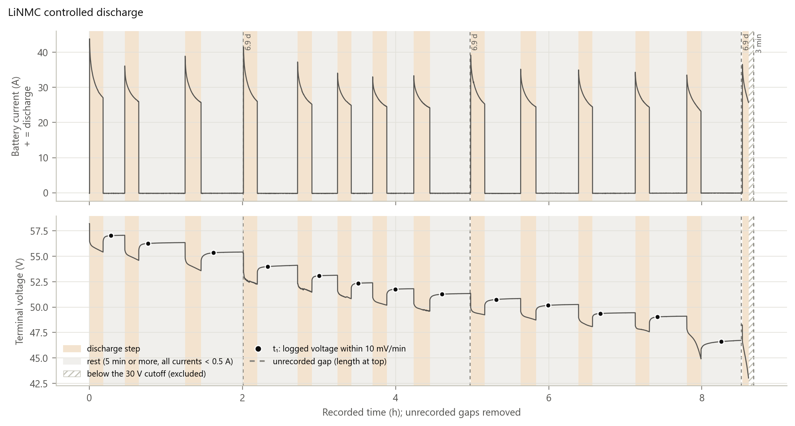

**Figure R1.** LiNMC controlled discharge, ADS1115 at 32 ms, 18 Mar – 8 Apr 2026: 8.68 h logged in four sessions. Battery current and terminal voltage are plotted on recorded time.
- Dashed lines are unrecorded intervals, with their length at the top (three of 6.9 days, one of 2.6 min). Lines are broken there.
- Shading: discharge steps (14, mean 26.2–31.1 A) and rests (13, all currents < 0.5 A for at least 5 min).
- Dots: t₁, where the logged voltage first changes by less than 10 mV/min.
- Hatched: below the 30 V cutoff, excluded.

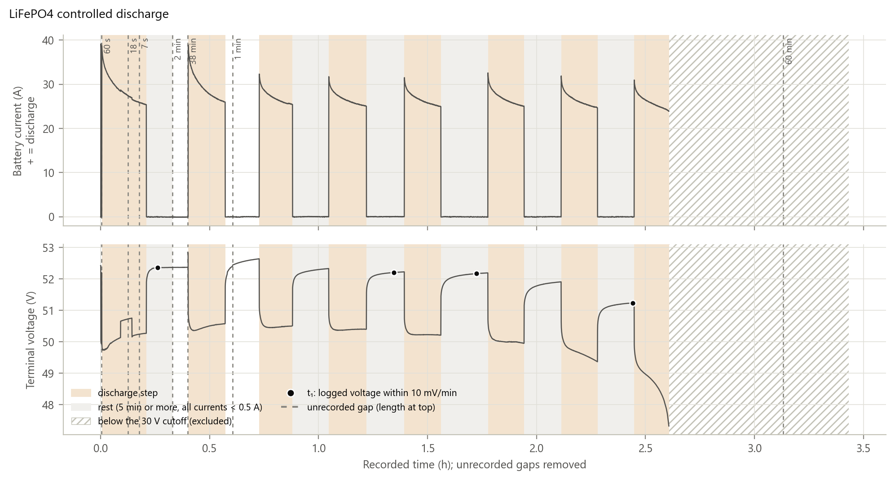

**Figure R2.** LiFePO4 controlled discharge, ADS8688 at 0.94 ms, 25 May 2026: 3.43 h logged in eight files. Layout as Figure R1.
- 11 discharge steps and 6 rests.
- t₁ was reached in 4 of the 6 rests.
- The interval marked 38 min lasted 31.5–38.5 min (Appendix D7).
- After the BMS cut-off at about 2.6 h, the voltage is below the cutoff (hatched, 0.82 h, excluded).

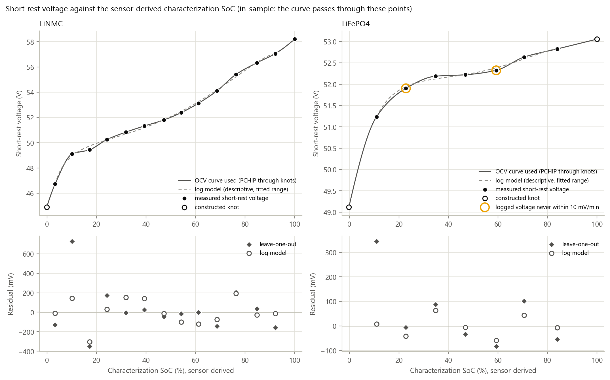

**Figure R3.** Short-rest voltage against the sensor-derived characterization SoC: LiNMC (left, 13 rests plus the rested start, ADS1115) and LiFePO4 (right, 7 rests, ADS8688).
- Filled dots: measured short-rest voltages. Open dots: constructed curve points.
- Solid line: the curve the estimators use (PCHIP through all points). Dashed line: a five-parameter log model, fitted over the measured range only.
- Rings: rests whose logged voltage never reached 10 mV/min.
- Bottom panels: leave-one-out and log-model residuals of each measured point.

All values are in-sample: the curve was built from these points.

## Current Sensor Offset

**Zero-current readings.** The zero-current readings use the idle rule that offset correction implements (Table R2). Each window starts 10 s after the rule begins to hold, which leaves out the switching transient, and lasts at least 20 s.
- The controlled runs have no MPPT or alternate-slot sensor, so those channels are left out there.
- Figure R4 plots each window's median reading against recorded time, with the within-window standard deviation as a bar and the learned offset as a line.
- Table R4 gives the numbers.
- No temperature was recorded, and no independent current reference was used during any run. The dates of the current-sensor calibration sessions are not available **[MISSING: D1]**, so no calibration events are marked.

**Offset, noise and change over time are of different sizes.**

*LiNMC controlled run (ADS1115)*
- The battery sensor read −0.163 A (median) under zero current, with a within-window SD of 0.007 A.
- Its window medians moved from −0.170 A in the first rest to −0.096 A in the last, over three weeks. That change (0.074 A) is about ten times the within-window SD.
- The load sensor's zero reading moved from −0.05 A to +0.04 A at the start of the 25 Mar session (Figure R4, 2.2 h).

*LiFePO4 controlled run (ADS8688)*
- Battery and load sensors read −0.039 A and −0.061 A, with within-window SDs of 0.025 A and 0.024 A.

*Operational runs*
- 12 Jun: the battery sensor read −0.154 A and −0.158 A, and the load sensor −0.218 A and −0.213 A (26 windows on GDT 2). The MPPT sensor read +0.054 A to +0.145 A.
- 22 Jun: every sensor read between −0.013 A and +0.002 A.
- 29 Jun:
  - In 3 of 5 idle windows the battery sensor read +0.001 to +0.002 A.
  - In two windows, of 2.0 and 2.4 min, it read +0.534 A and +0.463 A, with load and MPPT idle.
  - The idle rule accepts readings below 1 A, so these were learned as offset.
  - The data cannot show whether they are an offset or a real current through a branch the sensors do not measure.

**Before and after correction.** After correction, the output is 0 A at rest by construction, because readings below 0.3 A are set to 0 A. The table therefore reports the reading minus the learned offset, before that floor.
- Its median is within ±0.01 A for every sensor and run.
- Its largest values occur in short windows where the reading had just changed and the learned offset was still converging (time constant about 100 s): 0.177 A in the 2.4-min +0.463 A window on 29 Jun, and 0.062 A in a 0.5-min window at the start of the 1 Apr session of the LiNMC controlled run.

**Effect on integrated charge** (Table R5).
- **LiNMC controlled run.** Offset correction raised the battery's integrated net discharge from 69.84 Ah to 71.19 Ah: 1.35 Ah, or 1.89 pp of Q_total, over 8.68 h logged.
- **LiFePO4 controlled run.** The change was 0.09 Ah (0.25 pp).
- **Operational runs.**
  - 12 Jun: the change was +0.10 Ah and +0.05 Ah.
  - 22 Jun: −0.001 Ah.
  - 29 Jun: −0.25 Ah (−0.35 pp), where the two +0.5 A windows were learned as offset.
- **Projection.** If the zero reading observed on the LiNMC controlled run (−0.163 A) persisted for 12 h, a continuous half-day run, it would integrate to 1.95 Ah, or 2.73 pp of the LiNMC Q_total. The 12 Jun reading (−0.154 A) gives 2.59 pp. The LiFePO4 controlled reading (−0.039 A) gives 0.47 Ah, or 1.26 pp of the LiFePO4 Q_total. This is arithmetic on the observed offsets, not a measured result.

**ADC change.**

| | Battery zero readings (window medians) | Within-window SD |
|---|---|---|
| ADS1115 (LiNMC controlled) | −0.192 A to −0.079 A | 0.007 A |
| ADS8688 (five runs) | −0.159 A to +0.002 A (without the two 29 Jun windows at +0.5 A) | 0.008–0.038 A by sensor and run |

- The two sides differ in battery, wiring and sample rate (32 ms against 0.87–0.94 ms per sample before the median). No interval spans the change.
- So a discontinuity caused by the ADC can be neither identified nor excluded from these data.

From here on, coulomb counting, the EKF and EKF + KCL all integrate the offset-corrected current. The next section applies the four methods to the operational runs.

**Table R4.** Zero-current readings per sensor and run (window medians, A).

| Run (ADC) | Sensor | Windows (idle min) | Median reading | Lowest / highest window | First → last window | Within-window SD | Reading − learned offset: median / max \|·\| |
|---|---|---|---|---|---|---|---|
| LiNMC controlled (ADS1115) | Battery, main | 15 (361.6) | −0.163 | −0.192 / −0.079 | −0.170 → −0.096 | 0.007 | 0.000 / 0.062 |
| | Load | 15 (361.6) | +0.034 | −0.053 / +0.067 | −0.008 → +0.045 | 0.007 | −0.000 / 0.014 |
| LiFePO4 controlled (ADS8688) | Battery, main | 9 (72.8) | −0.039 | −0.088 / −0.007 | −0.059 → −0.047 | 0.025 | 0.000 / 0.013 |
| | Load | 11 (114.4) | −0.061 | −0.088 / −0.033 | −0.088 → −0.033 | 0.024 | 0.000 / 0.016 |
| GDT 1, 12 Jun (ADS8688) | Battery, main | 1 (0.4) | −0.154 | – | – | 0.021 | −0.009 / 0.009 |
| | Load | 4 (1.5) | −0.218 | −0.224 / −0.213 | −0.224 → −0.213 | 0.028 | −0.000 / 0.003 |
| | MPPT | 3 (6.7) | +0.109 | +0.105 / +0.145 | +0.109 → +0.145 | 0.024 | −0.001 / 0.043 |
| GDT 2, 12 Jun (ADS8688) | Battery, main | 2 (1.8) | −0.158 | −0.159 / −0.158 | −0.159 → −0.158 | 0.020 | −0.004 / 0.006 |
| | Load | 26 (26.8) | −0.213 | −0.223 / −0.180 | −0.180 → −0.208 | 0.025 | 0.000 / 0.015 |
| | MPPT | 1 (2.4) | +0.054 | – | – | 0.026 | −0.004 / 0.004 |
| LiFePO4, 22 Jun (ADS8688) | Battery, main (LiNMC, idle) | 6 (20.5) | +0.001 | +0.001 / +0.001 | +0.001 → +0.001 | 0.011 | −0.000 / 0.000 |
| | Battery, alternate (LiFePO4) | 6 (20.5) | +0.002 | +0.001 / +0.002 | +0.001 → +0.001 | 0.008 | 0.000 / 0.001 |
| | Load | 6 (20.5) | −0.011 | −0.012 / −0.001 | −0.001 → −0.011 | 0.023 | −0.002 / 0.006 |
| | MPPT | 1 (41.6) | −0.013 | – | – | 0.019 | −0.001 / 0.001 |
| LiNMC, 29 Jun (ADS8688) | Battery, main | 5 (14.5) | +0.002 | +0.001 / +0.534 | +0.001 → +0.463 | 0.030 | −0.000 / 0.177 |
| | Load | 4 (53.9) | −0.003 | −0.016 / +0.014 | +0.008 → +0.014 | 0.038 | −0.003 / 0.006 |
| | MPPT | 5 (32.3) | +0.001 | +0.001 / +0.002 | +0.001 → +0.001 | 0.014 | −0.001 / 0.001 |

**Table R5.** Effect of offset correction on the integrated net discharge of the evaluated battery, and the observed zero reading projected over 12 h.

| Run | Q_total (Ah) | Logged (h) | Net charge out, raw → offset-corrected (Ah) | Difference (Ah; pp of Q_total) | Battery zero reading (A) | Over 12 h (Ah; pp of Q_total) |
|---|---|---|---|---|---|---|
| LiNMC controlled | 71.43 | 8.68 | 69.84 → 71.19 | +1.35; +1.89 | −0.163 | 1.95; 2.73 |
| LiFePO4 controlled | 37.01 | 3.43 | 37.00 → 37.09 | +0.09; +0.25 | −0.039 | 0.47; 1.26 |
| GDT 1 (12 Jun) | 71.43 | 0.99 | −1.611 → −1.512 | +0.10; +0.14 | −0.154 | 1.85; 2.59 |
| GDT 2 (12 Jun) | 71.43 | 0.99 | −1.841 → −1.787 | +0.05; +0.08 | −0.158 | 1.90; 2.66 |
| LiFePO4 (22 Jun) | 37.01 | 0.70 | 0.585 → 0.584 | −0.001; −0.003 | +0.002 | 0.02; 0.06 |
| LiNMC (29 Jun) | 71.43 | 1.48 | −2.853 → −3.106 | −0.25; −0.35 | +0.002 | 0.03; 0.04 |

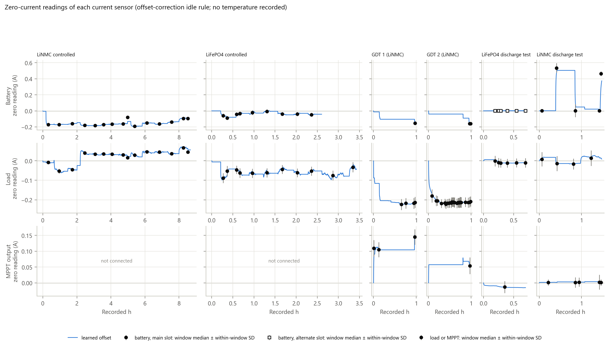

**Figure R4.** Zero-current readings of the four current sensors over all six runs, in date order: LiNMC controlled, LiFePO4 controlled, GDT 1, GDT 2, LiFePO4 (22 Jun), LiNMC (29 Jun).
- Each column is one run, on its own recorded-time axis.
- Dots: median of each zero-current window (idle rule of offset correction, first 10 s left out, at least 20 s long). Bars: within-window SD. Line: the offset learned by offset correction.
- The dashed vertical line separates the ADS1115 run from the ADS8688 runs. The change happened between 8 Apr and 25 May 2026, with no run spanning it.
- MPPT and alternate battery sensors were not connected in the controlled runs.
- No temperature was recorded. Calibration events are not marked (dates unavailable, Appendix D1).

## SoC Estimates for Operational Test

These are the four operational runs: three on the LiNMC bank in the main slot (12 Jun ×2, 29 Jun) and one on the LiFePO4 bank in the alternate slot (22 Jun). All were logged by the ADS8688.

**Starting SoC.** Every method starts from the same value, set as the server sets it on a fresh start: the row of the short-rest voltage table nearest the first voltage above the cutoff. At that first record the battery current was between −0.24 A and +0.01 A, and the inferred state was rest on all four runs (Table R6). This start is CC's initial SoC and the EKF's initial SoC estimate. OCV mapping has no state: its value at each step comes only from that step's voltage.

**Operating states.** The selector-switch positions were not logged **[MISSING: D5]**. Operating states are therefore inferred from the measured currents:
- **charging:** net battery current below −0.5 A;
- **discharging:** above +0.5 A;
- **rest:** every current below 0.5 A;
- **pass-through:** battery near 0 A while the MPPT or load carries current.

No slot voltage crossed 30 V during any run, so no battery slot was switched in or out. The alternate slot was disconnected throughout the three LiNMC runs, and both slots were connected throughout the 22 Jun run. The 12 Jun runs consist mostly of charging near full, the 22 Jun run of short discharges with rests, and the 29 Jun run of discharge followed by charging.

**Trajectories** (Figures R5, R6, A3 and A4; Table R6).

| Run | Start | End: CC | End: OCV mapping | End: EKF | End: EKF + KCL |
|---|---|---|---|---|---|
| LiNMC, 29 Jun | 93.42 % | 97.77 % | 99.23 % | 98.64 % | 98.70 % |
| LiFePO4, 22 Jun | 10.40 % | 8.83 % | 3.54 % | 3.55 % | 3.55 % |
| GDT 1, 12 Jun | 96.57 % | 98.68 % | 98.89 % | 98.77 % | 98.75 % |
| GDT 2, 12 Jun | 87.83 % | 90.33 % | 92.08 % | 91.14 % | 91.12 % |

**Where the trajectories separate.** Table R8 splits each pairwise difference into the change accumulated in each operating state. For each run, the rows add up to the difference at the end.
- **LiNMC runs.** The EKF − CC difference grew mainly while charging:
  - 29 Jun: +0.77 pp in 53.5 min of charging, against +0.03 pp in 21.5 min of discharging and +0.07 pp at rest;
  - GDT 2: +0.78 pp in 55.6 min of charging;
  - GDT 1: +0.08 pp.

  It reached its largest value at the end of each run: 0.87 pp (29 Jun), 0.82 pp (GDT 2) and 0.09 pp (GDT 1).
- **LiFePO4 run (22 Jun).** EKF − CC accumulated −7.06 pp in 18.6 min of discharging and recovered by +1.79 pp in 23.2 min of rest. Its largest magnitude was 5.38 pp, and it ended at −5.27 pp.
- **OCV mapping.** OCV mapping − CC moved most when the current changed:
  - It rose while charging (+4.65 pp on 29 Jun) and fell at rest (−2.33 pp) on the LiNMC runs.
  - On 22 Jun it fell while discharging (−14.43 pp) and rose at rest (+9.14 pp).
  - Its largest magnitudes were 5.72 pp (29 Jun, while charging), 5.73 pp (22 Jun, while discharging), 2.63 pp (GDT 2) and 1.00 pp (GDT 1).

  OCV mapping applies the short-rest voltage curve to the terminal voltage at every step, also while current flows. Its trace therefore includes the voltage drop or rise caused by the current, which shows as steps at every change of current in Figures R5 and R6.
- **EKF + KCL against EKF.** The two EKF variants stayed within 0.06 pp of each other on every run (largest 0.059 pp, 29 Jun). This is examined in Effect of KCL Correction.

Method disagreement builds up while current flows. Rests isolate each method's behaviour at zero current, and are examined next.

**Table R6.** Start and end of each operational run. Minutes per state are recorded time; logger stalls are excluded.

| Run | First-sample voltage (V) | Start SoC, all methods (%) | Battery current at the first record (A) | Elapsed wall clock (h) | Charging / discharging / rest / pass-through (min) | Verified rests (≥ 2 min) |
|---|---|---|---|---|---|---|
| GDT 1 (LiNMC, 12 Jun) | 57.64 | 96.57 | −0.19 | 0.99 | 50.6 / 2.8 / 5.7 / 0 | 0 |
| GDT 2 (LiNMC, 12 Jun) | 56.62 | 87.83 | −0.24 | 0.99 | 55.6 / 0 / 3.9 / 0 | 1 |
| LiFePO4 (22 Jun) | 51.19 | 10.40 | −0.01 | 0.73 | 0 / 18.6 / 23.2 / 0 | 4 |
| LiNMC (29 Jun) | 57.20 | 93.42 | +0.01 | 1.65 | 53.5 / 21.5 / 13.7 / 0.2 | 0 |

**Table R7.** Pairwise method disagreement (pp): largest magnitude, with its sign, time and state, and the value at the end.

| Run | Pair | Largest \|·\| (signed) | At (h); state | At end |
|---|---|---|---|---|
| GDT 1 (12 Jun) | OCV mapping − CC | +0.995 | 0.26; charging | +0.210 |
| | EKF − CC | +0.086 | 0.99; rest | +0.086 |
| | EKF + KCL − CC | +0.063 | 0.99; rest | +0.063 |
| | EKF + KCL − EKF | −0.023 | 0.96; rest | −0.023 |
| GDT 2 (12 Jun) | OCV mapping − CC | +2.632 | 0.41; charging | +1.755 |
| | EKF − CC | +0.819 | 0.99; rest | +0.819 |
| | EKF + KCL − CC | +0.791 | 0.99; rest | +0.791 |
| | EKF + KCL − EKF | −0.028 | 0.98; rest | −0.028 |
| LiFePO4 (22 Jun) | OCV mapping − CC | −5.729 | 0.16; discharging | −5.292 |
| | EKF − CC | −5.384 | 0.73; rest | −5.274 |
| | EKF + KCL − CC | −5.386 | 0.73; rest | −5.275 |
| | EKF + KCL − EKF | +0.005 | 0.37; discharging | −0.000 |
| LiNMC (29 Jun) | OCV mapping − CC | +5.716 | 0.61; charging | +1.467 |
| | EKF − CC | +0.873 | 1.65; rest | +0.873 |
| | EKF + KCL − CC | +0.933 | 1.65; rest | +0.933 |
| | EKF + KCL − EKF | +0.059 | 1.65; rest | +0.059 |

**Table R8.** Change in each pairwise difference accumulated in each inferred state (pp).

| Run | State (min) | OCV mapping − CC | EKF − CC | EKF + KCL − CC | EKF + KCL − EKF |
|---|---|---|---|---|---|
| GDT 1 (12 Jun) | charging (50.6) | +3.919 | +0.082 | +0.061 | −0.021 |
| | discharging (2.8) | −2.093 | −0.011 | −0.011 | +0.001 |
| | rest (5.7) | −1.616 | +0.016 | +0.013 | −0.003 |
| GDT 2 (12 Jun) | charging (55.6) | +3.329 | +0.780 | +0.754 | −0.026 |
| | rest (3.9) | −1.574 | +0.039 | +0.037 | −0.002 |
| LiFePO4 (22 Jun) | discharging (18.6) | −14.432 | −7.064 | −7.060 | +0.004 |
| | rest (23.2) | +9.140 | +1.789 | +1.785 | −0.004 |
| LiNMC (29 Jun) | charging (53.5) | +4.651 | +0.770 | +0.810 | +0.040 |
| | discharging (21.5) | −0.860 | +0.033 | +0.050 | +0.017 |
| | pass-through (0.2) | +0.008 | +0.004 | +0.003 | −0.000 |
| | rest (13.7) | −2.332 | +0.068 | +0.070 | +0.002 |

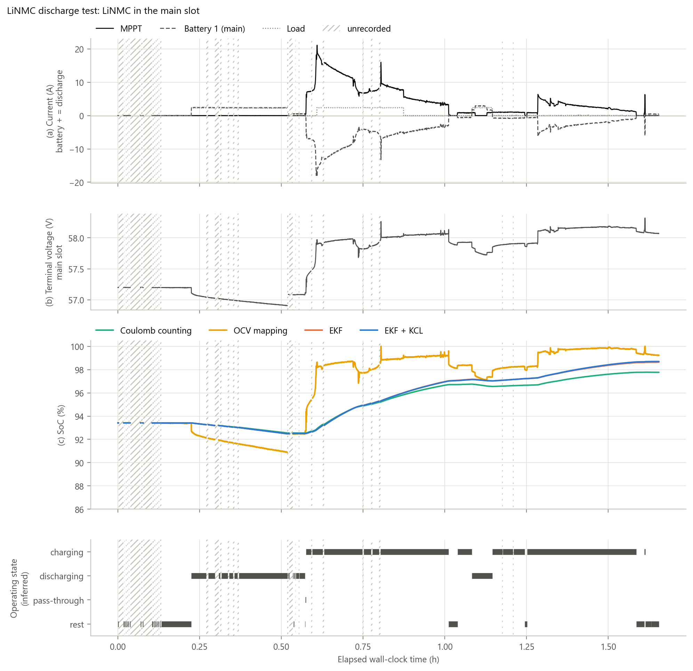

**Figure R5.** LiNMC operational run, main slot, 29 Jun 2026, ADS8688: 1.48 h logged over 1.65 h of wall-clock time.
- Panels:
  - (a) measured MPPT, battery and load currents (battery + = discharge);
  - (b) terminal voltage;
  - (c) SoC from the four methods, all started at 93.42 % (EKF + KCL is drawn over the EKF and differs from it by at most 0.059 pp);
  - (d) operating state inferred from the currents.
- Conditions: a rest, a 2.4 A discharge, MPPT charging at up to 21 A, and a short discharge between charging periods. There are no verified rests of 2 min or more.
- 32 logger stalls (10.4 min in total) are hatched, and lines are broken there.
- OCV mapping applies the short-rest voltage curve to the terminal voltage also while current flows.

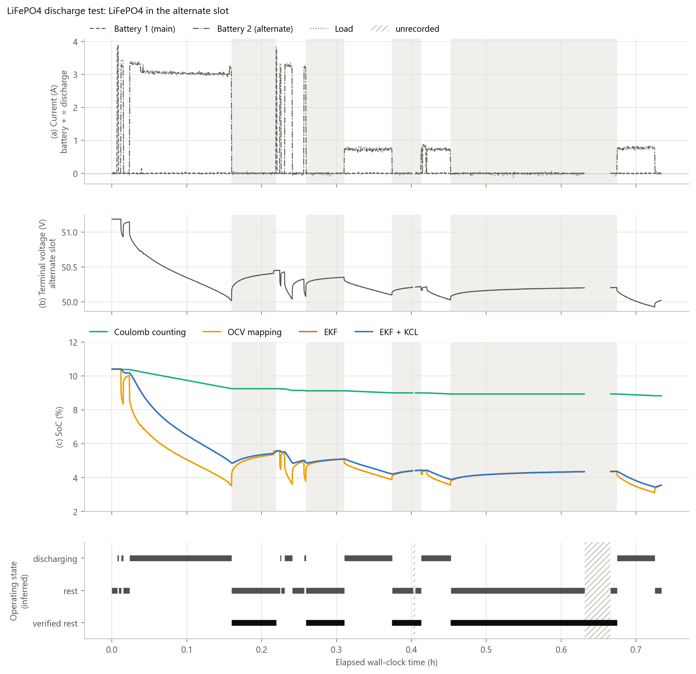

**Figure R6.** LiFePO4 operational run, alternate slot, 22 Jun 2026, ADS8688: 0.70 h logged over 0.73 h. Panels as in Figure R5; the start is 10.40 %.
- Conditions: discharges of about 3.3 A and 0.7 A, separated by rests.
- Four verified rests (every current below 0.5 A for at least 2 min) are shaded and drawn on their own lane.
- Two logger stalls (2.3 min in total) are hatched.
- The LiNMC in the main slot was connected and idle.

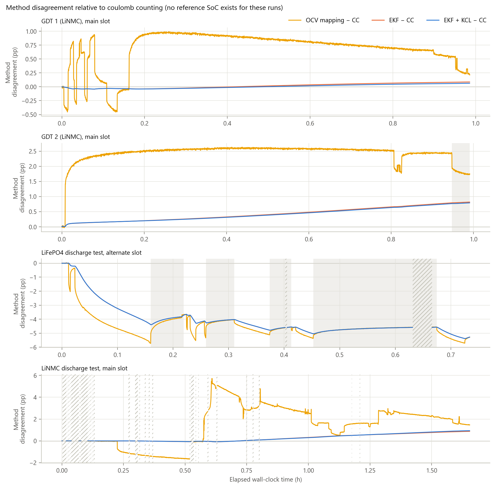

**Figure R7.** Method disagreement with coulomb counting over the four operational runs (pp): OCV mapping − CC, EKF − CC and EKF + KCL − CC.
- GDT 1 and GDT 2: LiNMC, 12 Jun, 0.99 h each, charging near full.
- LiFePO4: 22 Jun, 0.73 h.
- LiNMC: 29 Jun, 1.65 h.
- Shaded: verified rests. Hatched: logger stalls.

No reference SoC exists for these runs, so none of these differences is an error.

## SoC Behaviour During Rest

For each verified zero-current interval *j* and method *m*:

$$\Delta\mathrm{SoC}_{m,j} = \widehat{\mathrm{SoC}}_m(t_{\mathrm{end},j}) - \widehat{\mathrm{SoC}}_m(t_{0,j})$$

The same interval boundaries apply to every method:
- Every measured current (both batteries, load and MPPT) stays below 0.5 A, after a battery current above 1 A.
- t₀ is 10 s after the currents fall below 0.5 A, which leaves out the transition.
- t_end is the last record before any current exceeds 0.5 A.
- The minimum length is 5 min on the controlled runs and 2 min on the operational runs.
- Each rest is labelled by the sign of the battery current before it.

Requiring the MPPT current to be below 0.5 A means a disconnected load alone does not count as rest while the MPPT is charging.

**Counts.**
- **Operational:** 5 verified rests. One follows charge (GDT 2, LiNMC, 2.6 min). Four follow discharge (LiFePO4, 22 Jun, 2.1–11.2 min); two of those contain logger stalls of 11 s and 125 s, during which no current was integrated.
- **Controlled:** 13 LiNMC rests and 6 LiFePO4 rests, all after discharge.

No rest after charge exists for the LiFePO4 bank. With a 1-min minimum instead, the operational runs give 5 LiNMC rests after charge (Table B3).

**Close-ups** (Figure R8).
- *After discharge (LiFePO4, 22 Jun, rest 1, 3.6 min after a +3.1 A discharge).* The terminal voltage rose by 208 mV from t₀ to the end. OCV mapping rose by 1.02 pp and the EKF by 0.63 pp; coulomb counting stayed flat.
- *After charge (GDT 2, rest 1, 2.6 min after a −1.3 A charge).* The voltage fell by 21 mV. OCV mapping fell by 0.18 pp, while the EKF rose by 0.024 pp.

**All rests** (Figure R9, Table R9). Values are signed changes from t₀ to t_end.
- **Coulomb counting:** 0.000 pp in every rest. Its corrected input current is 0 A at rest by construction (the 0.3 A output floor).
- **OCV mapping:**

  | Rests | ΔSoC range | Median \|ΔSoC\| | Voltage change |
  |---|---|---|---|
  | Operational LiFePO4 | +0.28 to +1.02 pp | 0.42 pp | median +90 mV |
  | Operational LiNMC (after charge) | −0.18 pp | – | −21 mV |
  | Controlled LiNMC (in-sample) | +1.68 to +8.14 pp | 4.58 pp | median +534 mV |
  | Controlled LiFePO4 (in-sample) | +4.06 to +37.56 pp | 23.09 pp | median +500 mV |

  On the LiFePO4 controlled run, a rest with a 460 mV rise mapped to a 37.56 pp change.
- **EKF:**

  | Rests | ΔSoC range | Median \|ΔSoC\| |
  |---|---|---|
  | Operational LiFePO4 | +0.22 to +0.63 pp, all positive | 0.34 pp |
  | Operational LiNMC (after charge) | +0.024 pp | – |
  | Controlled LiNMC | −0.068 to +0.023 pp | 0.005 pp |
  | Controlled LiFePO4 | 0.000 to +0.019 pp | 0.000 pp |

  On the controlled LiFePO4 rests, the EKF value did not change (0.000 pp) in five of the six rests.
- **EKF + KCL:** within 0.009 pp of the EKF in every rest.

A flat coulomb-counting trace is expected when the corrected current is zero. A change in the EKF during relaxation is an estimator update. Neither flatness nor change alone shows which value is closer to the true SoC.

The same voltage update decides how quickly a method forgets a wrong starting value. This is tested next.

**Table R9.** Signed SoC change over each verified rest (t₀ → end), by data source, battery and preceding mode.

| Source, battery, preceding mode (n) | Method | Median \|ΔSoC\| (pp) | Max \|ΔSoC\| (pp) | Signed min / max (pp) | Median length (min) | Median ΔV (mV) |
|---|---|---|---|---|---|---|
| Operational, LiNMC, after charge (1) | CC | 0.000 | 0.000 | 0.000 / 0.000 | 2.6 | −21 |
| | OCV mapping | 0.182 | 0.182 | −0.182 / −0.182 | | |
| | EKF | 0.024 | 0.024 | +0.024 / +0.024 | | |
| | EKF + KCL | 0.023 | 0.023 | +0.023 / +0.023 | | |
| Operational, LiFePO4, after discharge (4) | CC | 0.000 | 0.000 | 0.000 / 0.000 | 3.3 | +90 |
| | OCV mapping | 0.424 | 1.022 | +0.278 / +1.022 | | |
| | EKF | 0.343 | 0.635 | +0.217 / +0.635 | | |
| | EKF + KCL | 0.342 | 0.636 | +0.214 / +0.636 | | |
| Controlled, LiNMC, after discharge (13; in-sample) | CC | 0.000 | 0.000 | 0.000 / 0.000 | 31.3 | +534 |
| | OCV mapping | 4.579 | 8.145 | +1.683 / +8.145 | | |
| | EKF | 0.005 | 0.068 | −0.068 / +0.023 | | |
| | EKF + KCL | 0.010 | 0.059 | −0.059 / +0.025 | | |
| Controlled, LiFePO4, after discharge (6; in-sample) | CC | 0.000 | 0.000 | 0.000 / 0.000 | 10.2 | +500 |
| | OCV mapping | 23.087 | 37.558 | +4.056 / +37.558 | | |
| | EKF | 0.000 | 0.019 | 0.000 / +0.019 | | |
| | EKF + KCL | 0.000 | 0.018 | 0.000 / +0.018 | | |

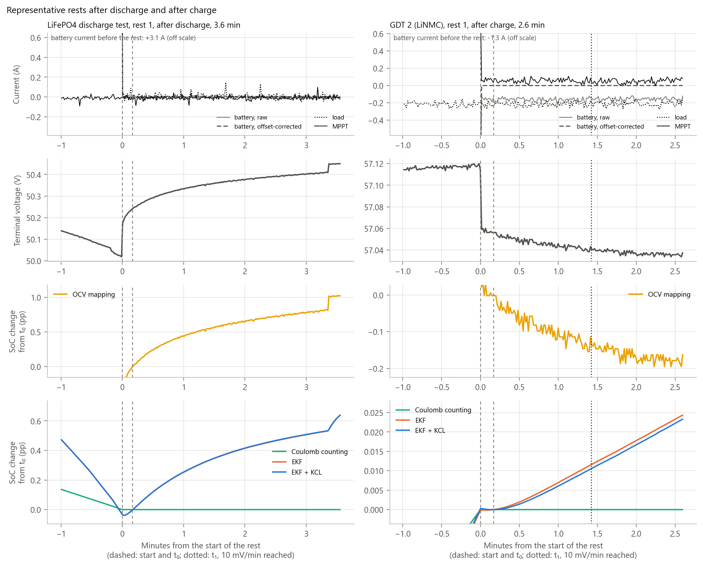

**Figure R8.** Representative rests, the median-length rest of each type in the operational runs (ADS8688).
- Left: LiFePO4, 22 Jun, rest 1 (3.6 min, after a +3.1 A discharge; 10 mV/min not reached).
- Right: GDT 2, LiNMC, 12 Jun, rest 1 (2.6 min, after a −1.3 A charge; 10 mV/min reached at 1.4 min).
- Rows: currents, terminal voltage, OCV-mapping SoC change from t₀, and CC, EKF and EKF + KCL SoC change from t₀.
- Dashed: rest start and t₀. Dotted: t₁.
- The y-axes are scaled from t₀, so earlier values may be clipped.

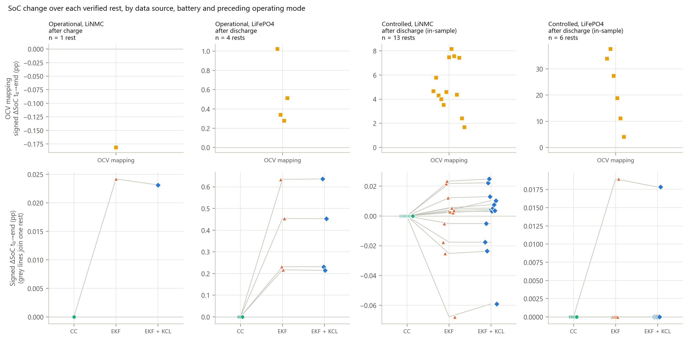

**Figure R9.** Signed SoC change over every verified rest, grouped by data source, battery and preceding operating mode.
- Groups and counts: operational LiNMC after charge (1), operational LiFePO4 after discharge (4), controlled LiNMC (13) and controlled LiFePO4 (6). The controlled rests are in-sample for OCV mapping and the EKF.
- Top row: OCV mapping, on its own scale.
- Bottom row: CC, EKF and EKF + KCL; grey lines join the values of one rest.
- ADC: ADS1115 for controlled LiNMC, ADS8688 for all others.

## Sensitivity to Initial SoC

**Replays.** Each operational run was replayed from five fixed initial SoC values: 10, 30, 50, 70 and 90 %. All other settings were left as they were.
- **Spread:** the maximum minus the minimum SoC across a method's replays, at each record (Figure R10, Table R10).
- **Threshold:** 1 pp, set before the replays were run.
- OCV mapping has no initial state and is marked not applicable.

**Coulomb counting.** The spread stayed at 80.0 pp from start to end on every run. The threshold was not reached, because the implementation has no step that resets SoC from a measurement.

**EKF and EKF + KCL, LiNMC runs.**
- After the first 1-s record, the spread was 10.6 pp (GDT 1), 19.5 pp (GDT 2) and 14.1 pp (29 Jun).
- It fell below 1 pp at the second record (0.00028 h, 1 s) and stayed below for the rest of each run.
- At the end the replays differed by at most 0.008 pp. Their end values were 98.769 % (GDT 1), 91.141–91.149 % (GDT 2) and 98.638–98.639 % (29 Jun).

**EKF and EKF + KCL, LiFePO4 run (22 Jun).**
- The spread stayed at 79.6 pp until 0.343 h. Until then, the replays started at 30–90 % were identical to coulomb counting from the same starts (largest difference 0.000 pp): those starts lie on the flat part of the curve, where the gated voltage update of the LiFePO4 EKF does not run (Table R2). The replay started at 10 % moved with the voltage from the start.
- At 0.343 h, 301 s after the last current of 1 A or more, the voltage update applied to all replays. The spread fell below 1 pp and stayed below.
- All five replays ended at 3.553 %.

The replays converge with each other. This shows reduced sensitivity to the starting guess, not convergence to the true SoC.

Every result so far uses offset-corrected current without the balance update. The last section adds that update.

**Table R10.** Spread within each method across the replays from 10, 30, 50, 70 and 90 % (pp).

| Run | Method | Spread after the first record | Spread at the end | First below 1 pp (h) | Below 1 pp from (h) to the end |
|---|---|---|---|---|---|
| GDT 1 (12 Jun) | CC | 80.0 | 80.0 | not reached | not reached |
| | EKF / EKF + KCL | 10.65 / 10.65 | 0.0006 / 0.0006 | 0.00028 | 0.00028 |
| GDT 2 (12 Jun) | CC | 80.0 | 80.0 | not reached | not reached |
| | EKF / EKF + KCL | 19.51 / 19.51 | 0.0075 / 0.0076 | 0.00028 | 0.00028 |
| LiFePO4 (22 Jun) | CC | 80.0 | 80.0 | not reached | not reached |
| | EKF / EKF + KCL | 79.62 / 79.62 | 0.0001 / 0.0001 | 0.343 | 0.343 |
| LiNMC (29 Jun) | CC | 80.0 | 80.0 | not reached | not reached |
| | EKF / EKF + KCL | 14.05 / 14.05 | 0.0002 / 0.0002 | 0.00028 | 0.00028 |
| all runs | OCV mapping | not applicable | not applicable | not applicable | not applicable |

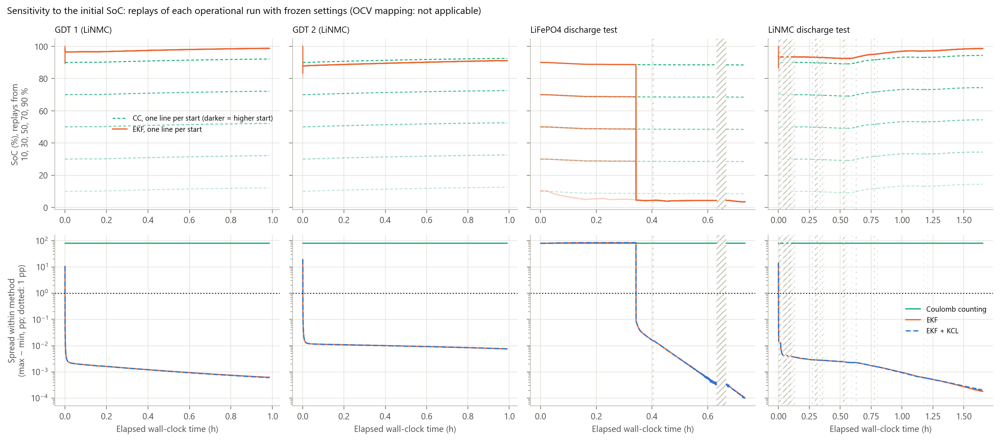

**Figure R10.** Replays of the four operational runs from initial SoC values of 10, 30, 50, 70 and 90 % with frozen settings. Runs: GDT 1 and GDT 2 (LiNMC, 12 Jun, 0.99 h each), LiFePO4 (22 Jun, 0.73 h) and LiNMC (29 Jun, 1.65 h), all ADS8688.
- Top: CC (dashed) and EKF (solid) trajectories; darker lines are higher starts.
- Bottom: spread within each method on a log scale, with the 1 pp threshold dotted.
- Logger stalls are hatched.
- OCV mapping has no initial state and is not shown.

## Effect of KCL Correction

**Residual.** The current-balance residual is defined at the junction of the battery selector switches:

$$r = I_{\mathrm{load}} - I_{\mathrm{MPPT}} - I_{\mathrm{bat,main}} - I_{\mathrm{bat,alt}}$$

- **Sign convention.** Battery current is positive when discharging, MPPT current positive out of the MPPT, load current positive into the load.
- **Measured branches.** All four are measured: MPPT net output (sensor HE1), load and motor controller (HE4), main battery (HE2) and alternate battery (HE3).
- **Disconnected slots.** A slot whose voltage is below 30 V counts as disconnected, and its current is set to 0 A.
- **Unmeasured branches.** Whether the 48–24 V converter that supplies the sensor board and Raspberry Pi draws through one of these branches is not established **[MISSING: D6]**.
- **Controlled runs.** Only load and battery were connected, so r reduces to load − battery.

**What is compared.** EKF and EKF + KCL share every setting and differ only in the battery current they integrate:
- EKF: offsets only;
- EKF + KCL: offsets plus the gated update that adjusts the offsets of the active sensors to drive r towards zero.

Records within 10 s after an inferred state change or a logger stall are left out of the summaries.

**Residual magnitude** (Table R11).

| Run | Median \|r\| raw | After offset correction | After the gated KCL update |
|---|---|---|---|
| LiNMC, 29 Jun | 0.240 A | 0.181 A | 0.047 A |
| GDT 1 | 0.162 A | 0.052 A | 0.032 A |
| GDT 2 | 0.082 A | 0.142 A | 0.029 A |
| LiFePO4, 22 Jun | 0.024 A | 0.024 A | 0.024 A |

- On 29 Jun the median raw residual was largest while charging (0.275 A, against 0.108 A discharging and 0.029 A at rest). On GDT 1 it was largest at rest (0.192 A).
- On GDT 2, offset correction alone increased the median residual while charging, from 0.080 A to 0.146 A.

The KCL update adjusts the offsets until r is near zero. A smaller corrected residual is therefore partly a consequence of the rule. It does not show that the corrected currents are closer to the physical currents.

**Corrections applied** (Figure R11, Figures A5–A7). On 29 Jun:
- **Battery sensor.** Offset correction alone removed 0 to +0.5 A, stepping where idle periods were learned. The gated KCL update removed up to 0.49 A, varying continuously while current flowed.
- **MPPT sensor.** The KCL update removed up to 0.095 A, against at most 0.0045 A for offsets alone.

**Effect on SoC** (Tables R11 and R12).

| Run | Largest \|EKF + KCL − EKF\| | At end | Battery charge changed by the update |
|---|---|---|---|
| GDT 1 | 0.023 pp | −0.023 pp | +0.043 Ah |
| GDT 2 | 0.028 pp | −0.028 pp | +0.040 Ah |
| LiFePO4, 22 Jun | 0.005 pp | 0.000 pp | +0.001 Ah |
| LiNMC, 29 Jun | 0.059 pp | +0.059 pp | −0.071 Ah |

- On 29 Jun the difference grew while charging (+0.039 pp) and discharging (+0.016 pp), and stayed flat at rest.
- Over the runs as recorded, the KCL update changed SoC by at most 0.059 pp.

**Sustained error on one channel** (Table R13, Figure A12). The 29 Jun run was also replayed as the monitoring server processed it at the time. In that version the server's flip latch negated every MPPT reading after one −10.24 A sample: a sustained 26-min error on one channel, not present in the recorded data.
- The battery charge credited by the gated KCL update fell from 3.177 Ah to 2.456 Ah.
- The largest battery-offset estimate rose from 0.49 A to 2.62 A.
- EKF + KCL ended 0.508 pp below the EKF, against 0.059 pp above it with the MPPT sign as recorded.
- The RMS voltage innovation of EKF + KCL rose from 14.5 mV to 23.0 mV, while the EKF stayed at 15.0 mV.
- The per-minute residual exceeded 2 A in 18 minutes, against 0 with the sign as recorded.

**Table R11.** KCL residual and the EKF + KCL − EKF difference by inferred state. Records within 10 s of a state change or stall are left out.

| Run | State (min) | Median \|r\|: raw / after offsets / after gated KCL (A) | \|EKF + KCL − EKF\|: median / max (pp) | Change in state (pp) |
|---|---|---|---|---|
| GDT 1 (12 Jun) | charging (49.7) | 0.159 / 0.055 / 0.031 | 0.015 / 0.023 | −0.021 |
| | discharging (2.1) | 0.183 / 0.030 / 0.033 | 0.000 / 0.001 | +0.000 |
| | rest (4.6) | 0.192 / 0.034 / 0.034 | 0.001 / 0.023 | −0.002 |
| | all (56.4) | 0.162 / 0.052 / 0.032 | 0.014 / 0.023 | −0.023 |
| GDT 2 (12 Jun) | charging (55.1) | 0.080 / 0.146 / 0.029 | 0.015 / 0.026 | −0.026 |
| | rest (3.2) | 0.106 / 0.035 / 0.027 | 0.027 / 0.028 | −0.001 |
| | all (58.3) | 0.082 / 0.142 / 0.029 | 0.016 / 0.028 | −0.027 |
| LiFePO4 (22 Jun) | discharging (17.2) | 0.031 / 0.031 / 0.029 | 0.002 / 0.005 | +0.001 |
| | rest (21.1) | 0.020 / 0.020 / 0.021 | 0.000 / 0.003 | −0.003 |
| | all (38.3) | 0.024 / 0.024 / 0.024 | 0.000 / 0.005 | −0.001 |
| LiNMC (29 Jun) | charging (51.4) | 0.275 / 0.220 / 0.048 | 0.015 / 0.058 | +0.039 |
| | discharging (19.3) | 0.108 / 0.113 / 0.041 | 0.004 / 0.022 | +0.016 |
| | rest (10.4) | 0.029 / 0.040 / 0.056 | 0.000 / 0.059 | +0.000 |
| | all (81.1) | 0.240 / 0.181 / 0.047 | 0.010 / 0.059 | +0.055 |

**Table R12.** Net battery charge out over each operational run (Ah; negative = net charge in).

| Run | Raw | Offsets only (CC, EKF) | Offsets + gated KCL (EKF + KCL) | Gated KCL − offsets only |
|---|---|---|---|---|
| GDT 1 (12 Jun) | −1.611 | −1.512 | −1.469 | +0.043 |
| GDT 2 (12 Jun) | −1.841 | −1.787 | −1.747 | +0.040 |
| LiFePO4 (22 Jun) | 0.585 | 0.584 | 0.585 | +0.001 |
| LiNMC (29 Jun) | −2.853 | −3.106 | −3.177 | −0.071 |

**Table R13.** 29 Jun LiNMC run: MPPT sign as recorded, against the run as the server processed it (flip latch on).

| | MPPT sign as recorded | As the server processed it |
|---|---|---|
| Battery charge out, offsets only (Ah) | −3.106 | −3.106 |
| Battery charge out, gated KCL (Ah) | −3.177 | −2.456 |
| Largest \|battery offset\|, gated KCL (A) | 0.488 | 2.617 |
| Largest \|MPPT offset\|, gated KCL (A) | 0.095 | 0.610 |
| EKF + KCL − EKF at the end (pp) | +0.059 | −0.508 |
| Largest per-minute \|EKF + KCL − EKF\| (pp) | 0.059 | 0.514 |
| Voltage innovation RMS, EKF (mV) | 15.0 | 15.0 |
| Voltage innovation RMS, EKF + KCL (mV) | 14.5 | 23.0 |
| Minutes with per-minute \|r\| > 2 A | 0 | 18 |

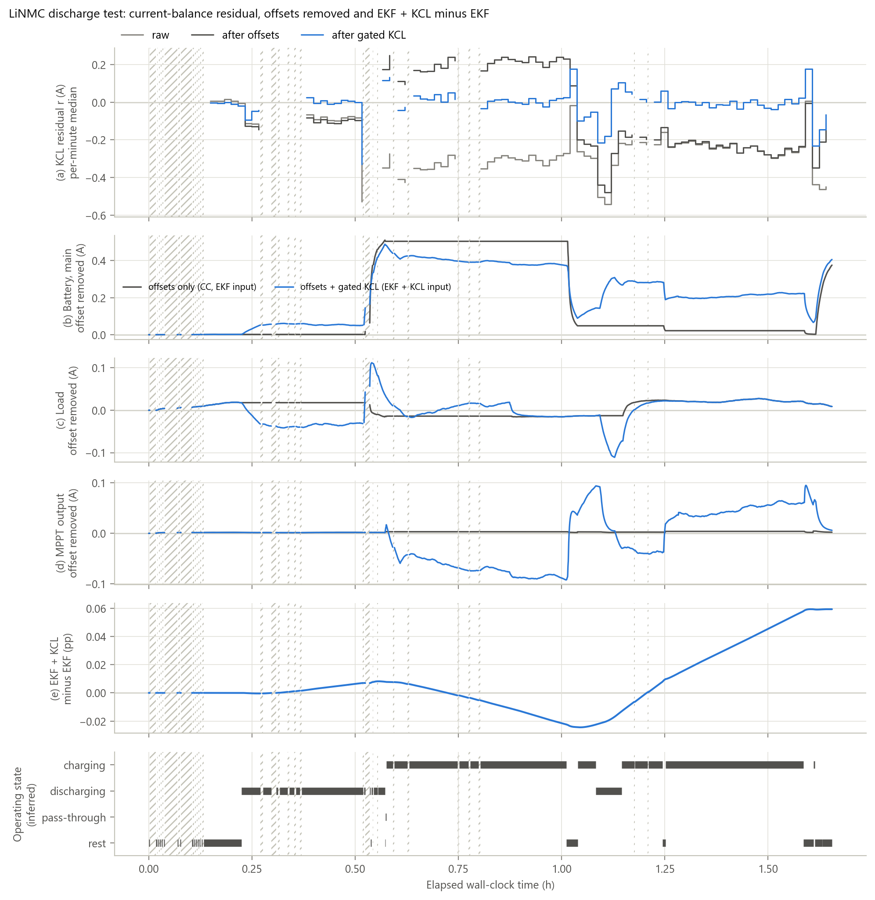

**Figure R11.** Current-balance correction on the LiNMC operational run, main slot, 29 Jun 2026, ADS8688: 1.48 h logged over 1.65 h, with discharge, charging up to 21 A, and rests. Panels:
- (a) per-minute median of the KCL residual: raw, after offset correction, and after the gated KCL update;
- (b–d) the offset removed from the battery, load and MPPT sensors by offset correction alone (CC and EKF input) and with the gated KCL update (EKF + KCL input). A channel below 0.3 A is output as 0 A whichever offset applies.
- (e) EKF + KCL minus EKF;
- (f) inferred operating state.

Logger stalls (32, 10.4 min in total) are hatched. No slot was switched in or out during the run, so no switching event is marked.

## Summary of Results

- **Characterization.** The controlled discharges gave usable capacities of 71.43 Ah (LiNMC, 71.4 % of rated) and 37.01 Ah (LiFePO4, 74.0 %). Of the rests at least 5 min long, 13 of 13 (LiNMC) and 4 of 6 (LiFePO4) reached 10 mV/min in the logged voltage. Over 22.8–59.3 % SoC, the LiFePO4 short-rest voltages span 11.6 mV per pp of SoC.
- **Offsets.**
  - Under zero current, the battery sensor read between −0.19 and +0.002 A in most windows. Two 29 Jun windows read +0.46 and +0.53 A.
  - On the LiNMC controlled run the reading moved by 0.074 A over three weeks, against a within-window SD of 0.007 A.
  - Offset correction changed the integrated LiNMC controlled charge by 1.35 Ah (1.89 pp).
  - No interval spans the ADC change, so its effect cannot be isolated.
- **Rest variation.**
  - Coulomb counting: 0 pp over every rest.
  - On the operational runs: EKF 0.22–0.63 pp after LiFePO4 discharges and 0.024 pp after the one LiNMC charge; OCV mapping 0.28–1.02 pp and −0.18 pp.
  - On the controlled runs (in-sample): EKF |ΔSoC| ≤ 0.068 pp; OCV mapping up to 8.1 pp (LiNMC) and 37.6 pp (LiFePO4).
  - Only one rest after charge exists.
- **Initialization sensitivity.**
  - Replays from 10–90 % kept an 80 pp spread under coulomb counting.
  - Under the EKF, the spread fell below 1 pp within 1 s on the LiNMC runs and at 0.343 h on the LiFePO4 run, and stayed below. All replays ended within 0.008 pp of each other.
- **KCL correction.**
  - The gated KCL update reduced the median residual to 0.029–0.047 A on the LiNMC runs, partly by construction.
  - It changed SoC by at most 0.059 pp against the EKF on the runs as recorded.
  - With one MPPT channel sign-reversed for 26 min (the 29 Jun run as the server processed it), EKF + KCL ended 0.508 pp below the EKF.
- **Limits.** These results describe estimator behaviour on land-based tests. They do not establish absolute SoC accuracy or performance at sea.
