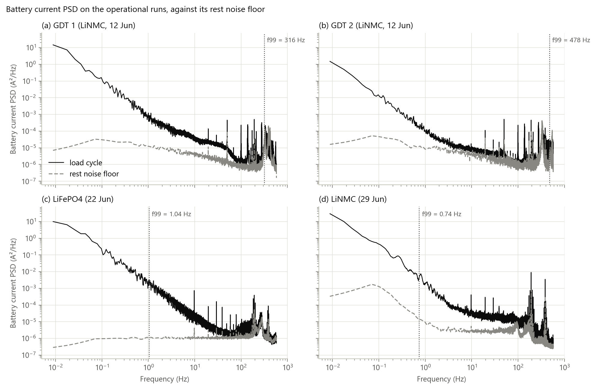
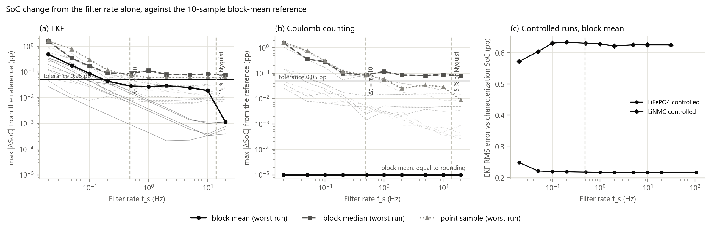

# Filter Sampling Rate

This section sets the minimum rate at which the SoC filter must run, and shows how that rate is calculated. Every number, table and figure comes from `final_report/sampling_rate.ipynb`, which calls the "sampling rate" block of `final_report/soc_eval.py`. It uses the six recorded runs of Table R1 and the frozen tuned filter settings of Table R2.

**Units.** SoC differences are in percentage points (pp). A rate f_s corresponds to a filter step Δt = 1/f_s.

## Method

Three criteria bound the rate. The minimum rate is the strictest one that applies to the filter as implemented:

$$
\Delta t \le \frac{\tau_1}{10} \quad\text{and}\quad f_s \ge \frac{f_{I,\max}}{0.075}\ \text{(point-sampled current only)},\qquad\text{confirmed by a rate-sensitivity sweep.}
$$

### Criterion 1: the fast RC time constant

The fast polarization branch has the shortest time constant, τ₁ = R₁C₁, so it constrains the step.
- **Exact discretization.** The EKF propagates each RC voltage exactly:
  $$v_{k+1} = a\,v_k + R(1-a)\,I_k, \qquad a = e^{-\Delta t/\tau}.$$
  This assumes the current is held constant over Δt (zero-order hold). The propagation therefore adds no discretization error of its own.
- **First-order comparison.** A first-order factor 1 − Δt/τ would add a relative error of about (Δt/τ)²/2 per step. This is 0.54 % at Δt/τ₁ = 0.1 and 0.13 % at 0.05 (Table S2). This is the check of Zhu and Zhu **[CITE: Zhu & Zhu, Taylor-truncation convergence, Fig. 4]**, which exact discretization makes unnecessary, as in Smyth and Wu **[CITE: Smyth & Wu, exact discretization]**.
- **Why Δt ≤ τ₁/10 is kept.** It bounds the zero-order-hold error of the current within a step. It also gives the filter about ten samples per fast relaxation.

τ₁ is read from the identified 2RC table of each battery, at its smallest value over SoC.

### Criterion 2: the bandwidth of the load current

The zero-order hold and the coulomb-counting integral are only accurate if the step resolves how fast the current changes. Smyth and Wu **[CITE: Smyth & Wu, integration analysis]** keep the frequencies of interest at or below about 15 % of the Nyquist frequency:

$$
f_{I,\max} \le 0.15\cdot\frac{f_s}{2} \;\Rightarrow\; f_s \ge \frac{f_{I,\max}}{0.075} \approx 13.3\,f_{I,\max}.
$$

f_I,max is measured from the logged battery current of the four operational runs (ADS8688, 1.15 kHz per channel):
- **Load-cycle PSD.** A Welch PSD over every connected sample, switching events included, with 2¹⁷-sample segments (114 s, 0.009 Hz resolution).
- **Noise floor.** The same PSD over rests in which every current stays below 0.5 A for at least 10 s (2¹⁴-sample segments).
- **f_I,max.** The frequency below which 99 % of the load-driven power lies, that is, of the load-cycle PSD minus the noise floor.

The rule assumes one sample stands for the whole step (point sampling). If the logged samples are averaged over each step instead, the integral of the current is kept exactly. Criterion 2 then does not limit the rate, and criterion 3 tests what remains.

### Criterion 3: rate-sensitivity sweep

The same tuned EKF, and coulomb counting (CC), were run on each recording reduced to 20, 10, 5, 2, 1, 0.5, 0.2, 0.1, 0.05 and 0.02 Hz. This follows Zhu and Zhu **[CITE: Zhu & Zhu, Fig. 10 and B2]** and Smyth and Wu **[CITE: Smyth & Wu, Table 2]**.

- **Reference.** The same filter on the block mean of 10 logged samples. This is the server's window: 8.7 ms (115 Hz) on the ADS8688 runs. On the ADS1115 LiNMC controlled run the reference is the logged 32 ms (31.25 Hz), and that run is swept from 10 Hz down.
- **Three ways of reducing the samples to one value per step:**
  - **block mean:** the voltage is the mean of the connected samples (above the 30 V cutoff); the current is the connected charge of the block divided by its length;
  - **block median:** the median of the connected samples, as the server's window does;
  - **point sample:** the first logged sample of the block, held over the step.
- **Rate-invariant tuning.** The voltage noise is set as a density (R = r/Δt) and the process noise grows with Δt. The filter's weighting per second is therefore the same at every rate, and no setting is retuned.
- **Raw current.** The battery current is used as logged, with no offset correction, so only the sampling differs between rates.
- **Statistics.** The sweep reports the largest and the RMS difference of the EKF SoC from the reference, and the largest difference of CC from the integral of every logged sample.
  - Operational runs: over every connected sample.
  - Controlled runs: over the fitted SoC range used in the rest of the evaluation (LiFePO4 11–84 %; LiNMC 3.4–92.2 %, first three sessions).
- **Tolerance: 0.05 pp.** For comparison, the EKF's RMS difference from the characterization estimate on the controlled runs is:
  - 0.13 pp (LiFePO4) and 0.25 pp (LiNMC) in the Results, with offset-corrected current;
  - 0.22 pp and 0.62 pp in this sweep, with raw current.

Three rules keep the sweep measuring the rate rather than other effects.
1. **Connected samples only in a block.** Without this rule, a 2.6 s logger dropout (0 V) on the LiNMC controlled run averaged into one 20 s block as 38.4 V. That value is above the cutoff, so the filter took it as a real voltage and its SoC moved by 1.07 pp.
2. **Discrete filter events.** Where the reference changes by more than 0.05 pp in one step, the voltage update has switched on at a steep part of the curve, for example −1.34 pp at 17.8 % SoC on the LiFePO4 controlled run. A filter at another rate makes the same jump slightly earlier or later. The largest-difference statistic therefore leaves out 10 s, or two steps if that is longer, around each such event. The RMS and end values keep every record.
   - Operational runs: nothing was left out.
   - LiFePO4 controlled: at most 30 s.
   - LiNMC controlled: at most 331 s, 1.1 % of its logged time.
3. **Fitted range.** Outside the fitted range, two values come from regions the model was not fitted to:
   - the BMS cut-off of the LiFePO4 controlled run, where the filter clips at 0 % by an amount that depends on the step (0.43 pp at 0.5 Hz);
   - the first update of the LiNMC controlled run at 99.9 % (0.054 pp at 2 Hz).
   These are excluded by scoring over the fitted range.

## Results

### Criterion 1

**Table S1.** Time constants of the identified 2RC models over the SoC table, and the step limit Δt ≤ τ₁,min/10.

| Battery | τ₁ min (s) | τ₁ max (s) | τ₂ min (s) | τ₂ max (s) | Δt max (s) | f_s min (Hz) |
|:--|--:|--:|--:|--:|--:|--:|
| LiNMC | 43.16 | 78.54 | 264.17 | 1037.04 | 4.32 | 0.23 |
| LiFePO4 | 20.90 | 28.79 | 191.65 | 256.45 | 2.09 | **0.48** |

**Table S2.** Relative error of a first-order decay factor 1 − Δt/τ₁ against the exact e^(−Δt/τ₁). The implemented filter uses the exact factor.

| Step | Δt/τ₁ | First-order factor error (%) |
|:--|--:|--:|
| Δt/τ₁ = 0.1 | 0.1 | 0.535 |
| Δt/τ₁ = 0.05 | 0.05 | 0.129 |
| Δt/τ₁ = 0.01 | 0.01 | 0.00503 |
| Server window, LiFePO4 (Δt = 8.7 ms) | 0.000414 | 8.6 × 10⁻⁶ |
| Server window, LiNMC on the ADS1115 (Δt = 320 ms) | 0.00741 | 0.00276 |

The LiFePO4 sets the limit. Its smallest τ₁ is 20.9 s, so Δt ≤ 2.09 s and **f_s ≥ 0.48 Hz**. The LiNMC needs only f_s ≥ 0.23 Hz.

### Criterion 2

**Table S3.** Battery-current bandwidth on the operational runs (ADS8688, 1.15 kHz). "Load-driven" is the load-cycle PSD minus the rest noise floor.

| Run | Welch segments (cycle / rest) | Load-driven rms (A) | of which above 10 Hz (A rms) | Rest noise floor (A rms) | f90 (Hz) | f_I,max = f99 (Hz) | f_I,max / 0.075 (Hz) |
|:--|:--|--:|--:|--:|--:|--:|--:|
| GDT 1 (LiNMC, 12 Jun) | 31 / 17 | 0.501 | 0.066 | 0.069 | 0.053 | 316 | 4210 |
| GDT 2 (LiNMC, 12 Jun) | 31 / 12 | 0.164 | 0.057 | 0.071 | 141 | 478 | 6370 |
| LiFePO4 (22 Jun) | 22 / 86 | 0.506 | 0.027 | 0.033 | 0.088 | 1.04 | **13.9** |
| LiNMC (29 Jun) | 46 / 42 | 0.697 | 0.048 | 0.035 | 0.079 | 0.74 | 9.9 |

**Figure S1.** Battery-current PSD over the whole load cycle (solid) and over rests (dashed, noise floor) on the four operational runs. ADS8688 at 1.15 kHz; Welch segments 114 s (load cycle) and 14 s (rest). Dotted line: f99 of the load-driven power.

- **Discharge runs (22 and 29 Jun).** These switch the load. On both, 90 % of the load-driven power lies below 0.09 Hz and 99 % below 1.04 Hz. With point sampling, this gives f_s ≥ 13.9 Hz.
- **Charging runs (12 Jun).** These carry almost no load switching. Their 99 % bandwidth is set by tonal components between about 50 Hz and the 577 Hz Nyquist limit of the logger, at 0.057–0.066 A rms. The source of these components was not identified.
  - At these frequencies the rule would need 4.2–6.4 kHz, above the 1.15 kHz logged rate. The hardware could reach it (about 20 kS/s per channel while streaming), but averaging removes the requirement, so a faster logging rate is not needed.
  - Averaging the logged samples over each step removes the requirement: the block-mean integral is the integral of every logged sample.

### Criterion 3

**Table S4.** Largest SoC difference from the reference, worst of the six runs, at each rate (pp).

| f_s (Hz) | EKF, block mean | EKF, block median | EKF, point sample | CC, block mean | CC, block median | CC, point sample |
|--:|--:|--:|--:|--:|--:|--:|
| 20 | 0.001 | 0.078 | 0.060 | 0.000 | 0.081 | 0.009 |
| 10 | 0.019 | 0.085 | 0.063 | 0.000 | 0.088 | 0.029 |
| 5 | 0.025 | 0.078 | 0.060 | 0.000 | 0.081 | 0.035 |
| 2 | 0.029 | 0.081 | 0.060 | 0.000 | 0.085 | 0.025 |
| 1 | 0.027 | 0.113 | 0.062 | 0.000 | 0.116 | 0.059 |
| 0.5 | 0.028 | 0.087 | 0.071 | 0.000 | 0.087 | 0.086 |
| 0.2 | **0.044** | 0.091 | 0.120 | 0.000 | 0.100 | 0.120 |
| 0.1 | 0.088 | 0.168 | 0.307 | 0.000 | 0.282 | 0.307 |
| 0.05 | 0.179 | 0.344 | 0.772 | 0.000 | 0.362 | 0.774 |
| 0.02 | 0.489 | 1.559 | 1.640 | 0.000 | 1.560 | 1.645 |

**Table S5.** Lowest swept rate keeping every run within 0.05 pp, at that rate and every higher one.

| Reduction | Minimum rate (Hz) | Worst difference there (pp) | Next lower rate (Hz) | Worst difference there (pp) |
|:--|--:|--:|--:|--:|
| Block mean | 0.2 | 0.044 | 0.1 | 0.088 |
| Block median | none | – | 20 | 0.081 |
| Point sample | none | – | 20 | 0.060 |

**Figure S2.** SoC difference caused by the filter rate alone, on all six runs. Reference: the same filter on the 10-sample block mean (115 Hz on the ADS8688; 31.25 Hz logged on the ADS1115 LiNMC controlled run, which is swept from 10 Hz).
- (a) EKF and (b) coulomb counting: largest difference from the reference. Bold: worst run; thin: each run. The block-mean CC difference is zero to rounding and is drawn at 10⁻⁵ pp. The worst block-mean EKF curve falls at 20 Hz because the LiNMC controlled run is not swept there.
- (c) EKF RMS difference from the characterization estimate over the fitted SoC range of the two controlled runs, with block-mean input. This is in-sample: each model was fitted to the run it is scored on.
- Dashed lines: Δt = τ₁/10 for the LiFePO4 (0.48 Hz) and the 15 %-of-Nyquist rate for f_I,max = 1.04 Hz (13.9 Hz).

**Block mean.**
- **Coulomb counting.** Block-mean CC equals the integral of every logged sample at every rate (Table S4), as the charge-preserving block mean requires.
- **EKF.** The EKF difference stays at or below 0.029 pp from 20 Hz down to 0.5 Hz. It is 0.044 pp at 0.2 Hz, 0.088 pp at 0.1 Hz, 0.179 pp at 0.05 Hz and 0.489 pp at 0.02 Hz.
- **Operational runs alone.** The difference at 0.5 Hz is at most 0.015 pp (GDT 2).
- **Against the characterization estimate (Figure S2c).** The EKF's RMS difference is flat from the reference rate down to 0.1 Hz:
  - LiFePO4: 0.217–0.219 pp, rising to 0.248 pp at 0.02 Hz;
  - LiNMC: 0.621–0.633 pp.

**Block median.** The median is not charge-preserving. Its CC differs from the logged integral by 0.08–0.12 pp at every rate from 20 Hz down to 0.5 Hz, so no rate meets the tolerance.
- At the server's own rate (10-sample median at 107–115 Hz), CC differs from the block mean by 0.004–0.010 pp on the operational runs (up to 1 h).
- It differs by 0.060 pp on the 3.4 h LiFePO4 controlled run.

**Point sample.** Even at 20 Hz the EKF differs by 0.060 pp (GDT 2), so a single sample's noise sets a floor independent of rate. The difference then rises from 0.071 pp at 0.5 Hz to 1.64 pp at 0.02 Hz.

### Minimum rate

**Table S6.** Minimum filter rate by criterion.

| Criterion | Minimum f_s (Hz) | Basis |
|:--|--:|:--|
| 1. Time constant | 0.48 | Δt ≤ τ₁/10, LiFePO4 τ₁,min = 20.9 s |
| 2. Current bandwidth | 13.9 | f_s ≥ f_I,max/0.075, f_I,max = 1.04 Hz; applies to point sampling only |
| 3. Sweep, block mean | 0.2 | every run within 0.05 pp |
| 3. Sweep, block median | none | CC charge difference 0.08–0.12 pp at every rate |
| 3. Sweep, point sample | none | 0.060 pp at 20 Hz |
| **Minimum** | **0.48** | stricter of criterion 1 and the block-mean sweep |

With the logged samples averaged over each step (block mean of connected samples), the minimum filter rate is **f_s = 0.48 Hz (Δt ≤ 2.09 s)**. It is set by the LiFePO4's fast time constant.
- The sweep alone would allow 0.2 Hz. At 0.5 Hz, the nearest swept rate above the minimum, the worst run differs by 0.028 pp.
- If the current is point-sampled instead, criterion 2 requires f_s ≥ 13.9 Hz. Even then, single-sample noise keeps the EKF 0.06 pp from the averaged reference.

The implemented server runs well above this minimum:
- ADS8688: the 10-sample median window gives about 115 Hz, 240× the minimum;
- ADS1115: 3.1 Hz, 6.5× the minimum.

Its window takes the median rather than the mean, which changes the integrated charge by up to 0.060 pp on the runs analysed.

## Paragraph for the report

The filter was executed at f_s ≈ 115 Hz: the median of every 10 samples of the ADS8688, logged at 1.15 kHz per channel; the ADS1115 controlled run gives 3.1 Hz. With the identified fast polarization time constant τ₁ = 20.9 s (LiFePO4, smallest over SoC; 43.2 s for the LiNMC), this gives Δt/τ₁ = 4.1 × 10⁻⁴. The RC dynamics were discretized exactly under a zero-order-hold assumption, so discretization error arises only from intra-sample current variation. Following Smyth and Wu **[CITE]**, who recommend keeping the frequencies of interest below about 15 % of the Nyquist frequency to bound integration error, f_s exceeds 13.3× the highest significant frequency of the load current: f_I,max = 1.04 Hz, the 99 % bandwidth of the load-driven battery-current PSD on the discharge runs, which requires f_s ≥ 13.9 Hz. Current was acquired at 1.15 kS/s per channel and reduced to f_s in windows of 10 samples. The logger was configured at 1.2 kS/s per channel; the hardware sustains about 20 kS/s per channel while streaming (32 kS/s without serial output; Section **[ADC selection]**), so the logging rate was a configuration choice, not a hardware limit. A rate-sensitivity study (Figure S2), analogous to Zhu and Zhu **[CITE]**, shows that with block averaging the SoC is insensitive to f_s above 0.2 Hz (largest difference 0.044 pp against the full-rate filter). Combined with Δt ≤ τ₁/10, this sets a minimum of 0.48 Hz, and the operating rate provides a 240× margin above it.

## Notes for the author

- **Citations.** The Smyth & Wu and Zhu & Zhu citations are placeholders. Add the bibliography keys; the figure and table numbers quoted are those given in the brief and have not been checked against the papers.
- **ADC rate.** The firmware sets `SAMPLING_RATE 1200`; the logged data shows 1.15 kHz per channel on the ADS8688 (all eight channels) and 31.25 Hz on the ADS1115. The firmware benchmarks give the hardware headroom: 258 kSPS over 8 channels without serial output (32 kS/s per channel) and 163 kSPS while streaming (630 KB/s, about 20 kS/s per channel). The single-core ESP32 cannot read the ADC while writing; a dual-core part could overlap the two. Those details belong in the ADC selection section; this section cites only the headroom. Replace **[ADC selection]** in the paragraph with that section's number.
- **Median versus mean.** The server reduces each 10-sample window by its median, not its mean. On the runs analysed this changes integrated charge by 0.004–0.060 pp. A charge-preserving mean, with samples below the 30 V cutoff left out, would remove this; the server code has not been changed.
- **High-frequency components.** The tonal components above 50 Hz on the 12 Jun charging runs (Figure S1a and b) are not identified. They may come from MPPT converter ripple aliased by the logger, but this was not tested.
